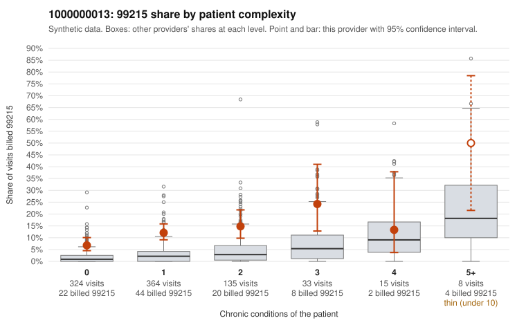

# Payment Integrity dossier: 1000000013

> Draft for human review. Statistical and records-sample evidence only; not a finding. Compliance or legal review is needed before any provider contact, notice or recoupment.

## Provider overview

| | |
|---|---|
| Specialty / state | Family Practice, GA (synthetic) |
| Claims / patients | 879 / 429 |
| Billed mix (99211 to 99215) | 2 / 2 / 125 / 650 / 100 |
| 99215 share | 11.4% |
| Expected 99215 share given patient complexity | 2.3% |
| Screen scores | z vs peers 1.22; risk-adjusted 7.20; flagged by suspicion>=5 |

## Case summary (advisory)

**Elevated 99215 billing concentrated on low-complexity patients is consistent with upcoding, but records are too thin to confirm it.**

Leaning: pattern consistent with upcoding. Citations checked: 4/4 valid.

1000000013 billed 99215 on 11.4% of 879 claims against an expected 2.3% given patient complexity (risk-adjusted score 7.20; plain z-score vs peers 1.22). 66% of this provider's 99215 claims were on patients with 0 or 1 chronic conditions. Records came back for 19 claims. Of 1 documented 99215 claims, 0 (0%) were documented below the billed level, against 0% for the comparison providers. 1 of 15 notes claiming moderate-or-higher data reviewed had no lab or test line on the claim. The excess 99215 billing does not look like a sicker panel: it appears in every complexity stratum, including patients with no chronic conditions, and most of the 99215s fall on low-complexity patients. Sampled examples are routine presentations such as upper respiratory infection (C0006472, C0007205), low back pain (C0006824, C0007039) and follow-up visits (C0006584, C0006871). The heavy 99214 share, including simple visits like C0006548 and C0006904, points the same way. The high-complexity 99215s (e.g., C0006615, C0006902) look plausible, and the modest plain z-score means the signal depends on risk adjustment. The main gap is documentation: only one 99215 was reviewed (C0007273, supported), and the one unsupported 99214 (C0007269) is a single case, so the records neither confirm nor rule out upcoding. A reviewer should first request charts for the sampled low-complexity 99215 claims and check whether documented MDM or time actually supports the high level. Examples: C0007269: billed 99214; documented MDM level low, minutes not recorded. C0006462: billed 99215, patient aged 35 with 0 chronic condition(s). C0006472: billed 99215, patient aged 52 with 0 chronic condition(s). C0006476: billed 99215, patient aged 82 with 1 chronic condition(s) (type 2 diabetes).

## Evidence chart

## Records-review sample so far

Documentation is on file for 19 claims (2% of this provider's claims).

| Billed | Documented | Documentation below billed level | Rate | All-provider rate |
|---|---|---|---|---|
| 99213 | 3 | 0 | 0.0% | 1.6% |
| 99214 | 15 | 1 | 6.7% | 3.2% |
| 99215 | 1 | 0 | 0.0% | 0.0% |

## Recommended next steps for Payment Integrity

1. Request records for the sampled claims in `record_request_list.csv` (41 claims across 99215).
2. Review the records against E/M documentation rules and record the supported level for each claim.
3. Run the overpayment estimator on the reviewed sample (`sampling_plan.md` explains how).
4. Notice, appeal rights, recoupment, education or corrective action, and any referral are decisions for the PI team, compliance and counsel. Nothing here drafts those.

Suggested follow-ups from the case summary:

- Request the full records for the cited claims and have a certified coder re-score each against current E/M documentation rules (medical decision making or total time).
- If the re-scoring confirms the pattern, use the sampling plan in the recovery packet to review a statistical sample of this provider's 99215 claims.
- Check whether notes for the cited claims look copied forward, and whether documented minutes repeat from visit to visit.

## Limits

- Synthetic data; no real claims or providers.
- The leaning is advisory. The flag comes from the statistical screen; the summary explains it.
- The records-review sample is partial and was simulated for this project.
- Allowed amounts are GA Family Practice averages from a public CMS file, not this provider's actual payments.
