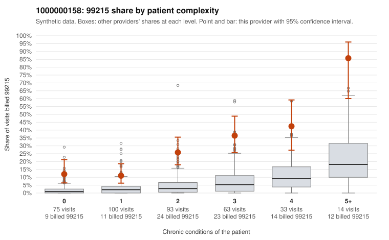

# Payment Integrity dossier: 1000000158

> Draft for human review. Statistical and records-sample evidence only; not a finding. Compliance or legal review is needed before any provider contact, notice or recoupment.

## Provider overview

| | |
|---|---|
| Specialty / state | Family Practice, GA (synthetic) |
| Claims / patients | 378 / 189 |
| Billed mix (99211 to 99215) | 1 / 1 / 66 / 217 / 93 |
| 99215 share | 24.6% |
| Expected 99215 share given patient complexity | 3.8% |
| Screen scores | z vs peers 3.67; risk-adjusted 8.42; flagged by suspicion>=5 |

## Case summary (advisory)

**Provider 1000000158's 99215 rate runs well above peers in every complexity band, including patients with few or no chronic conditions, but there are too few charts to confirm or rule out upcoding.**

Leaning: pattern consistent with upcoding. Citations checked: 3/3 valid.

1000000158 billed 99215 on 24.6% of 378 claims against an expected 3.8% given patient complexity (risk-adjusted score 8.42; plain z-score vs peers 3.67). 22% of this provider's 99215 claims were on patients with 0 or 1 chronic conditions. Records came back for 20 claims. Of 5 documented 99215 claims, 0 (0%) were documented below the billed level, against 0% for the comparison providers. 3 of 18 notes claiming moderate-or-higher data reviewed had no lab or test line on the claim. The excess is not explained by a sicker panel: the by-complexity table shows 99215 shares several times the all-provider rate even for patients with 0 or 1 conditions, and the sampled low-complexity 99215 claims carry simple diagnoses such as upper respiratory infection (J06.9), rash (R21), follow-up exams (Z09) and single-condition visits, including three sampled 99215s for patient M0035378 coded for osteoarthritis alone (C0083717, C0083868, C0083937). The documentation does not contradict the billed levels, since all documented 99215 claims were supported, but five charts is too thin a base to judge. One of those supported charts, C0083951, is a single-condition hypothyroidism visit documented as high MDM, which deserves a look for cloned or inflated notes. The 3 notes claiming moderate-or-higher data review with no lab or test line are weak evidence in the same direction, not proof. A reviewer should first request charts for the sampled low-complexity 99215 claims, especially the repeat M0035378 visits and the J06.9, R21 and Z09 encounters, and check whether their MDM and time actually support level 5. Examples: C0083696: billed 99215, patient aged 53 with 1 chronic condition(s) (type 2 diabetes). C0083717: billed 99215, patient aged 61 with 1 chronic condition(s) (osteoarthritis). C0083758: billed 99215, patient aged 55 with 0 chronic condition(s).

## Evidence chart

## Records-review sample so far

Documentation is on file for 20 claims (5% of this provider's claims).

| Billed | Documented | Documentation below billed level | Rate | All-provider rate |
|---|---|---|---|---|
| 99213 | 2 | 0 | 0.0% | 1.6% |
| 99214 | 13 | 0 | 0.0% | 3.2% |
| 99215 | 5 | 0 | 0.0% | 0.0% |

## Recommended next steps for Payment Integrity

1. Request records for the sampled claims in `record_request_list.csv` (40 claims across 99215).
2. Review the records against E/M documentation rules and record the supported level for each claim.
3. Run the overpayment estimator on the reviewed sample (`sampling_plan.md` explains how).
4. Notice, appeal rights, recoupment, education or corrective action, and any referral are decisions for the PI team, compliance and counsel. Nothing here drafts those.

Suggested follow-ups from the case summary:

- Request the full records for the cited claims and have a certified coder re-score each against current E/M documentation rules (medical decision making or total time).
- If the re-scoring confirms the pattern, use the sampling plan in the recovery packet to review a statistical sample of this provider's 99215 claims.
- Check whether notes for the cited claims look copied forward, and whether documented minutes repeat from visit to visit.

## Limits

- Synthetic data; no real claims or providers.
- The leaning is advisory. The flag comes from the statistical screen; the summary explains it.
- The records-review sample is partial and was simulated for this project.
- Allowed amounts are GA Family Practice averages from a public CMS file, not this provider's actual payments.
