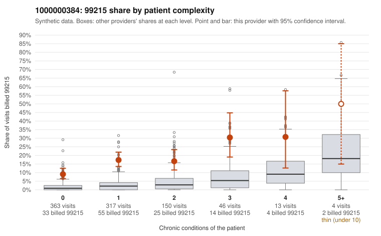

# Payment Integrity dossier: 1000000384

> Draft for human review. Statistical and records-sample evidence only; not a finding. Compliance or legal review is needed before any provider contact, notice or recoupment.

## Provider overview

| | |
|---|---|
| Specialty / state | Family Practice, GA (synthetic) |
| Claims / patients | 893 / 453 |
| Billed mix (99211 to 99215) | 4 / 6 / 190 / 560 / 133 |
| 99215 share | 14.9% |
| Expected 99215 share given patient complexity | 2.2% |
| Screen scores | z vs peers 1.87; risk-adjusted 10.23; flagged by suspicion>=5 |

## Case summary (advisory)

**Provider 1000000384's 99215 billing is concentrated on low-complexity patients seen for routine problems, which looks more like upcoding than a sicker panel, though too few charts were reviewed to confirm it.**

Leaning: pattern consistent with upcoding. Citations checked: 3/3 valid.

1000000384 billed 99215 on 14.9% of 893 claims against an expected 2.2% given patient complexity (risk-adjusted score 10.23; plain z-score vs peers 1.87). 66% of this provider's 99215 claims were on patients with 0 or 1 chronic conditions. Records came back for 17 claims. Of 3 documented 99215 claims, 0 (0%) were documented below the billed level, against 0% for the comparison providers. 1 of 14 notes claiming moderate-or-higher data reviewed had no lab or test line on the claim. The elevated 99215 rate holds in every complexity tier, including patients with no chronic conditions, and most of this provider's 99215s fall on low-complexity patients, so a sicker panel does not explain the pattern. The sampled low-complexity 99215s are mostly for minor or routine diagnoses in younger patients, such as a rash (C0187064, C0187108, C0187182), an upper respiratory infection (C0187415, C0187785), a urinary tract infection (C0187027, C0187486) or a follow-up visit (C0187608, C0187811); this is consistent with upcoding, and the heavy use of 99214 suggests the whole distribution may be shifted upward. The main ambiguity is the documentation: only a small fraction of claims have records, and the three documented 99215s (C0187087, C0187672, C0187709) all support high MDM, although that sample is far too small to outweigh the claims pattern or to rule out cloned or templated notes. A reviewer should first request charts for the sampled low-complexity 99215 claims listed above, then check whether their MDM and time documentation genuinely supports high complexity or repeats boilerplate across visits. Examples: C0186884: billed 99215, patient aged 56 with 1 chronic condition(s) (COPD). C0186885: billed 99215, patient aged 36 with 1 chronic condition(s) (hyperlipidemia). C0186887: billed 99215, patient aged 23 with 1 chronic condition(s) (hyperlipidemia).

## Evidence chart

## Records-review sample so far

Documentation is on file for 17 claims (2% of this provider's claims).

| Billed | Documented | Documentation below billed level | Rate | All-provider rate |
|---|---|---|---|---|
| 99213 | 1 | 0 | 0.0% | 1.6% |
| 99214 | 13 | 0 | 0.0% | 3.2% |
| 99215 | 3 | 0 | 0.0% | 0.0% |

## Recommended next steps for Payment Integrity

1. Request records for the sampled claims in `record_request_list.csv` (46 claims across 99215).
2. Review the records against E/M documentation rules and record the supported level for each claim.
3. Run the overpayment estimator on the reviewed sample (`sampling_plan.md` explains how).
4. Notice, appeal rights, recoupment, education or corrective action, and any referral are decisions for the PI team, compliance and counsel. Nothing here drafts those.

Suggested follow-ups from the case summary:

- Request the full records for the cited claims and have a certified coder re-score each against current E/M documentation rules (medical decision making or total time).
- If the re-scoring confirms the pattern, use the sampling plan in the recovery packet to review a statistical sample of this provider's 99215 claims.
- Check whether notes for the cited claims look copied forward, and whether documented minutes repeat from visit to visit.

## Limits

- Synthetic data; no real claims or providers.
- The leaning is advisory. The flag comes from the statistical screen; the summary explains it.
- The records-review sample is partial and was simulated for this project.
- Allowed amounts are GA Family Practice averages from a public CMS file, not this provider's actual payments.
