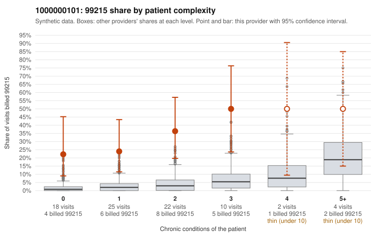

# 1000000101: Provider 1000000101's 99215 share is elevated even among patients with no or few chronic conditions, but the few charts returned all support the billed level, so the documentation is too thin to tell upcoding from a complex panel.

**Leaning (advisory):** Inconclusive

## Why

1000000101 billed 99215 on 32.1% of 81 claims against an expected 3.2% given patient complexity (risk-adjusted score 5.41; plain z-score vs peers 5.42). 38% of this provider's 99215 claims were on patients with 0 or 1 chronic conditions. Records came back for 15 claims. Of 4 documented 99215 claims, 0 (0%) were documented below the billed level, against 14% for the comparison providers. 0 of 10 notes claiming moderate-or-higher data reviewed had no lab or test line on the claim. The excess 99215 billing appears in every complexity stratum, not only among the sickest patients. The low-complexity sample includes 99215 visits for routine-looking diagnoses such as upper respiratory infection (C0042952), rash (C0042962) and urinary tract infection (C0042967, C0042971), which is the pattern most consistent with upcoding. Against that, all four documented 99215 claims were supported at high MDM, and none of the notes claiming moderate-or-higher data review lacked a lab or test line. However, four charts is far too few to clear the pattern, and the rule check agrees there is not enough documentation to lean either way. One supported claim deserves a closer look: C0042967 is a high-MDM 99215 for a urinary tract infection in a patient with no chronic conditions, and its minutes were not recorded, so the reviewer should check whether that note is templated or cloned. The first step should be requesting additional charts, prioritizing the low-complexity 99215 claims listed in the packet, to test whether the high-level billing on simple acute problems holds up. Examples: C0042949: billed 99215, patient aged 47 with 1 chronic condition(s) (COPD). C0042952: billed 99215, patient aged 60 with 0 chronic condition(s).

## Evidence chart

## Cited claims

`C0042949`, `C0042952`

## Suggested next steps

- Request records for a larger sample of this provider's 99214 and 99215 claims; what came back is too thin to judge.
- Re-screen the provider once the records arrive.

---
Citations checked: 2/2 valid. Synthetic data. The leaning is advisory; the flag comes from the statistical screen, and no clinical documentation is available beyond the sampled records-review facts shown in the packet.
