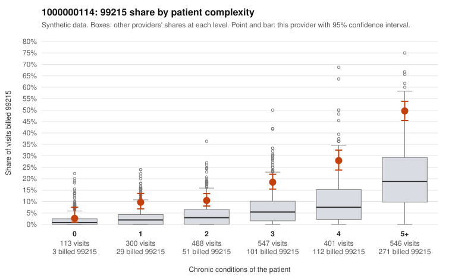

# 1000000114: Provider 1000000114 bills 99215 well above its risk-adjusted expectation in every complexity band, but the few charts returned all support the billed level, so the evidence points both ways.

**Leaning (advisory):** Inconclusive

## Why

1000000114 billed 99215 on 23.7% of 2,395 claims against an expected 6.9% given patient complexity (risk-adjusted score 11.94; plain z-score vs peers 3.75). 6% of this provider's 99215 claims were on patients with 0 or 1 chronic conditions. Records came back for 19 claims. Of 7 documented 99215 claims, 0 (0%) were documented below the billed level, against 14% for the comparison providers. 0 of 10 notes claiming moderate-or-higher data reviewed had no lab or test line on the claim. The excess is not explained by panel mix: the 99215 share runs at roughly two to three times the all-provider rate in every chronic-condition band, and billing is compressed toward 99214/99215 with almost no low-level visits, which fits a uniform coding habit rather than a sicker panel alone. Against that, most 99215s fall on multi-morbid patients, all 7 documented 99215s were supported at high MDM (e.g., C0051562, C0051924), and there is no sign of inflated data-review notes on claims lacking lab or test lines. The documentation is too thin to settle the question, because records cover under 1% of claims and only 7 are 99215s. A reviewer should first pull a larger targeted chart sample, starting with sampled low-complexity 99215s such as C0051802 (rash, no chronic conditions), C0053120 (back pain, no chronic conditions) and the single-condition follow-up (Z09) visits like C0050947 and C0052973. The reviewer should also check whether the high-band 99215s show visit-specific MDM rather than templated notes. Examples: C0050738: billed 99215, patient aged 28 with 1 chronic condition(s) (hypertension). C0050947: billed 99215, patient aged 47 with 1 chronic condition(s) (hypertension).

## Evidence chart

## Cited claims

`C0050738`, `C0050947`

## Suggested next steps

- Request records for a larger sample of this provider's 99214 and 99215 claims; what came back is too thin to judge.
- Re-screen the provider once the records arrive.

---
Citations checked: 2/2 valid. Synthetic data. The leaning is advisory; the flag comes from the statistical screen, and no clinical documentation is available beyond the sampled records-review facts shown in the packet.
