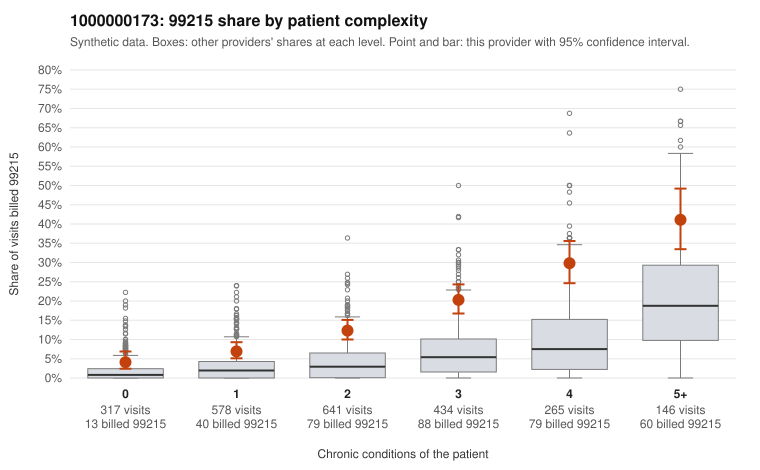

# 1000000173: Provider 1000000173 bills 99215 well above its risk-adjusted expectation in every complexity tier, but records came back for too few claims to tell upcoding from a complex panel.

**Leaning (advisory):** Inconclusive

## Why

1000000173 billed 99215 on 15.1% of 2,381 claims against an expected 4.1% given patient complexity (risk-adjusted score 10.02; plain z-score vs peers 2.04). 15% of this provider's 99215 claims were on patients with 0 or 1 chronic conditions. Records came back for 17 claims. Of 1 documented 99215 claims, 0 (0%) were documented below the billed level, against 14% for the comparison providers. 0 of 10 notes claiming moderate-or-higher data reviewed had no lab or test line on the claim. The billing pattern points toward upcoding more than toward panel acuity. The 99215 share runs roughly two to three times the all-provider rate in every complexity band, including 0-1 condition patients. The low-complexity sample shows level-5 visits for problems like back pain (C0084397), upper respiratory infection (C0084474) and rash (C0084532), which are hard to square with high-complexity decision-making. On the other side, the 99215 rate rises steeply with condition count, and the high-complexity sample (e.g., C0084637, C0085580) looks consistent with legitimately demanding visits, so part of the excess may reflect a sicker-than-average panel within each band. The documentation cannot settle the question: only one documented 99215 (C0084535, supported at high MDM, no time recorded) plus a handful of 99213/99214 charts came back. The absence of mismatches and of data-reviewed notes without lab lines therefore says little either way. A reviewer should first request charts for the sampled low-complexity 99215 claims (starting with the acute-symptom visits coded R10.9, R21, J06.9 and M54.50) and check whether the documented MDM or time actually supports level 5. Examples: C0083783: billed 99215, patient aged 35 with 1 chronic condition(s) (hyperlipidemia). C0083796: billed 99215, patient aged 18 with 0 chronic condition(s).

## Evidence chart

## Cited claims

`C0083783`, `C0083796`

## Suggested next steps

- Request records for a larger sample of this provider's 99214 and 99215 claims; what came back is too thin to judge.
- Re-screen the provider once the records arrive.

---
Citations checked: 2/2 valid. Synthetic data. The leaning is advisory; the flag comes from the statistical screen, and no clinical documentation is available beyond the sampled records-review facts shown in the packet.
