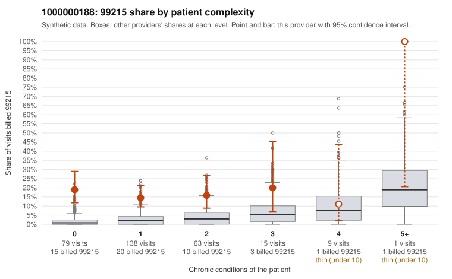

# 1000000188: Provider 1000000188 bills 99215 far above expectation, mostly on 0–1 condition patients, but only 4 documented 99215 charts came back, too few to call the pattern upcoding or a sicker panel.

**Leaning (advisory):** Inconclusive

## Why

1000000188 billed 99215 on 16.4% of 305 claims against an expected 2.2% given patient complexity (risk-adjusted score 6.08; plain z-score vs peers 2.31). 70% of this provider's 99215 claims were on patients with 0 or 1 chronic conditions. Records came back for 16 claims. Of 4 documented 99215 claims, 0 (0%) were documented below the billed level, against 14% for the comparison providers. 2 of 9 notes claiming moderate-or-higher data reviewed had no lab or test line on the claim. The billing pattern leans toward concern: the elevated 99215 share is concentrated in the lowest-complexity strata, where peers rarely bill 99215, and the sampled low-complexity 99215 claims carry simple diagnoses such as abdominal pain, back pain, rash and upper respiratory infection (e.g., C0092639, C0092640, C0092794). The documentation points the other way, since all 4 documented 99215 claims were supported, but that sample is too thin to settle the question, and records came back for only a small share of claims. Three of the supported charts (C0092630, C0092639, C0092830) record high MDM for patients with 0–1 chronic conditions and routine complaints. That is a weak signal that notes may be templated or inflated to match the billed level rather than reflecting the visit, as is the mismatch between data-reviewed claims and missing lab or test lines. A reviewer should first obtain more charts for the low-complexity 99215 claims and compare them across visits for cloned language, checking whether the documented MDM elements (problems, data, risk) are plausible for a URI or back-pain visit. Examples: C0092809: billed 99212; documented MDM level minimal, minutes not recorded. C0092581: billed 99215, patient aged 50 with 1 chronic condition(s) (atrial fibrillation). C0092584: billed 99215, patient aged 56 with 0 chronic condition(s).

## Evidence chart

## Cited claims

`C0092809`, `C0092581`, `C0092584`

## Suggested next steps

- Request records for a larger sample of this provider's 99214 and 99215 claims; what came back is too thin to judge.
- Re-screen the provider once the records arrive.

---
Citations checked: 3/3 valid. Synthetic data. The leaning is advisory; the flag comes from the statistical screen, and no clinical documentation is available beyond the sampled records-review facts shown in the packet.
