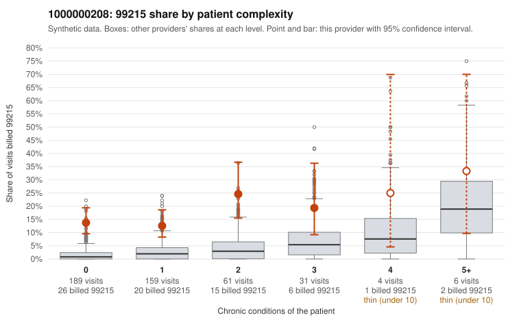

# 1000000208: Provider 1000000208's 99215 billing is concentrated on low-complexity patients with routine diagnoses, a pattern consistent with upcoding, though the chart review is too thin to confirm it.

**Leaning (advisory):** Pattern consistent with upcoding

## Why

1000000208 billed 99215 on 15.6% of 450 claims against an expected 2.1% given patient complexity (risk-adjusted score 7.24; plain z-score vs peers 2.14). 66% of this provider's 99215 claims were on patients with 0 or 1 chronic conditions. Records came back for 17 claims. Of 2 documented 99215 claims, 1 (50%) were documented below the billed level, against 14% for the comparison providers. 4 of 11 notes claiming moderate-or-higher data reviewed had no lab or test line on the claim. The strongest signal is the mismatch between billed level and patient complexity. The elevated 99215 share holds in every complexity stratum, and most sampled low-complexity 99215 claims carry simple diagnoses such as urinary tract infection (N39.0) or abdominal pain (R10.9), for example C0104222, C0104248 and C0104610, rather than the multi-condition profiles seen in C0104511. Documentation cannot yet confirm or refute this: only two 99215 charts came back, one supported and one below the billed level (C0104368). The supported one, C0104637, is an upper respiratory infection on a patient with no chronic conditions documented at high MDM, which deserves a close look for inflated or templated notes. The share of moderate-or-higher data-reviewed notes with no lab or test line on the claim is weak supporting evidence that some notes may not reflect what happened. A reviewer should first request charts for the sampled low-complexity 99215 claims, starting with the N39.0 and R10.9 visits, and check whether the MDM and time documentation genuinely supports level 5. Examples: C0104368: billed 99215; documented MDM level moderate, minutes not recorded. C0104222: billed 99215, patient aged 42 with 0 chronic condition(s). C0104248: billed 99215, patient aged 33 with 0 chronic condition(s). C0104273: billed 99215, patient aged 30 with 1 chronic condition(s) (type 2 diabetes).

## Evidence chart

## Cited claims

`C0104368`, `C0104222`, `C0104248`, `C0104273`

## Suggested next steps

- Request the full records for the cited claims and have a certified coder re-score each against current E/M documentation rules (medical decision making or total time).
- If the re-scoring confirms the pattern, use the sampling plan in the recovery packet to review a statistical sample of this provider's 99215 claims.
- Check whether notes for the cited claims look copied forward, and whether documented minutes repeat from visit to visit.

---
Citations checked: 4/4 valid. Synthetic data. The leaning is advisory; the flag comes from the statistical screen, and no clinical documentation is available beyond the sampled records-review facts shown in the packet.
