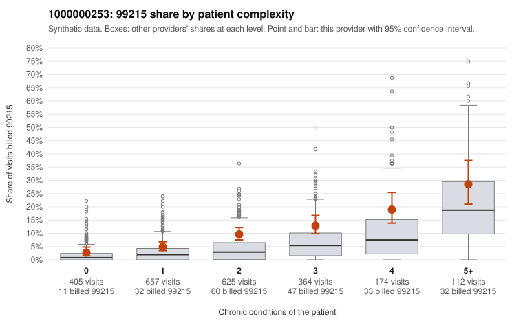

# 1000000253: Provider 1000000253 bills 99215 well above expectation in every complexity tier, including low-complexity patients, but no 99215 charts came back, so the documentation cannot yet confirm or refute upcoding.

**Leaning (advisory):** Inconclusive

## Why

1000000253 billed 99215 on 9.2% of 2,337 claims against an expected 3.5% given patient complexity (risk-adjusted score 5.37; plain z-score vs peers 0.88). 20% of this provider's 99215 claims were on patients with 0 or 1 chronic conditions. Records came back for 17 claims. No documented 99215 claims came back. 1 of 11 notes claiming moderate-or-higher data reviewed had no lab or test line on the claim. The elevated 99215 rate is not explained by panel acuity alone. The 99215 share runs above the all-provider share in every condition-count stratum, from zero conditions up through 5+, and the billing mix overall sits heavily at 99214, which suggests a general upward shift rather than a few very sick patients. The sampled low-complexity 99215 claims include visits where the only diagnosis is low back pain, an upper respiratory infection or a follow-up code, such as C0122452, C0122494, C0123335 and C0124512. These are the kind of encounters where a top-level visit is hard to justify, while the high-complexity samples (e.g., C0122109, C0124007) look clinically plausible. The plain peer z-score is unremarkable, and the records review is too thin to judge. No 99215 claims were documented, and only one unsupported 99213 and one note claiming moderate-or-higher data review without a test line appeared, both too few to read much into. A reviewer should first request and review charts for a targeted set of 99215 claims, prioritizing the low-complexity samples above, to see whether the documented medical decision making or time supports the billed level. Examples: C0122551: billed 99213; documented MDM level straightforward, minutes not recorded. C0122422: billed 99215, patient aged 54 with 1 chronic condition(s) (hypertension). C0122452: billed 99215, patient aged 52 with 0 chronic condition(s).

## Evidence chart

## Cited claims

`C0122551`, `C0122422`, `C0122452`

## Suggested next steps

- Request records for a larger sample of this provider's 99214 and 99215 claims; what came back is too thin to judge.
- Re-screen the provider once the records arrive.

---
Citations checked: 3/3 valid. Synthetic data. The leaning is advisory; the flag comes from the statistical screen, and no clinical documentation is available beyond the sampled records-review facts shown in the packet.
