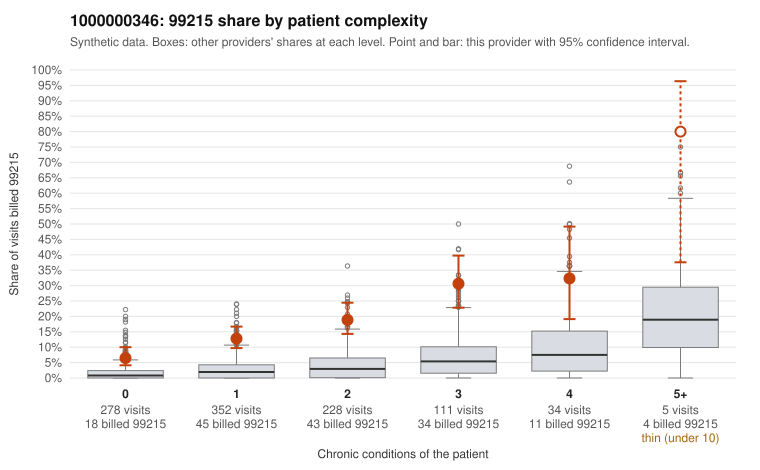

# 1000000346: Provider 1000000346 bills 99215 well above expectation at every complexity level, including many visits for patients with few or no chronic conditions, but too few charts came back to confirm or rule out upcoding.

**Leaning (advisory):** Inconclusive

## Why

1000000346 billed 99215 on 15.4% of 1,008 claims against an expected 2.4% given patient complexity (risk-adjusted score 9.69; plain z-score vs peers 2.10). 41% of this provider's 99215 claims were on patients with 0 or 1 chronic conditions. Records came back for 15 claims. Of 4 documented 99215 claims, 0 (0%) were documented below the billed level, against 14% for the comparison providers. 0 of 9 notes claiming moderate-or-higher data reviewed had no lab or test line on the claim. The claims pattern leans toward concern. The 99215 share runs several times the all-provider rate in every complexity stratum, not just among the sickest patients, and the sampled low-complexity 99215 claims carry routine diagnoses such as upper respiratory infection, rash, back pain and follow-up codes (e.g., C0167468, C0167419, C0167462). Against that, the few charts returned all support the billed level, and none of the notes claiming substantial data review lacked a lab or test line. That sample is far too small to outweigh the claims pattern or confirm it, so the rule check correctly declines to lean. One documented 'supported' claim deserves a closer look: C0167693 was billed and documented as high MDM with 54 minutes for a patient with no chronic conditions and a rash diagnosis, which may reflect a genuinely complex encounter or an inflated or templated note. A reviewer should first request a larger, targeted set of records for the low-complexity 99215 claims, starting with those listed. They should check whether the MDM and time documentation reflects what actually happened at each visit or repeats across notes. Examples: C0167054: billed 99215, patient aged 53 with 1 chronic condition(s) (COPD). C0167067: billed 99215, patient aged 50 with 1 chronic condition(s) (hypertension).

## Evidence chart

## Cited claims

`C0167054`, `C0167067`

## Suggested next steps

- Request records for a larger sample of this provider's 99214 and 99215 claims; what came back is too thin to judge.
- Re-screen the provider once the records arrive.

---
Citations checked: 2/2 valid. Synthetic data. The leaning is advisory; the flag comes from the statistical screen, and no clinical documentation is available beyond the sampled records-review facts shown in the packet.
