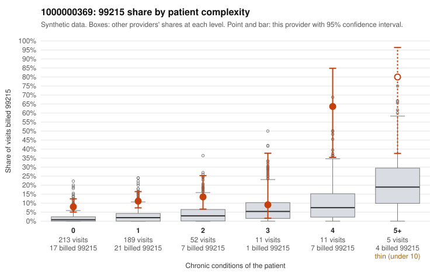

# 1000000369: High 99215 rate is concentrated on low-complexity patients, but with only 2 documented 99215 charts the records are too thin to confirm or rule out upcoding.

**Leaning (advisory):** Inconclusive

## Why

1000000369 billed 99215 on 11.8% of 481 claims against an expected 1.9% given patient complexity (risk-adjusted score 5.67; plain z-score vs peers 1.40). 67% of this provider's 99215 claims were on patients with 0 or 1 chronic conditions. Records came back for 15 claims. Of 2 documented 99215 claims, 0 (0%) were documented below the billed level, against 14% for the comparison providers. 1 of 8 notes claiming moderate-or-higher data reviewed had no lab or test line on the claim. The claims pattern leans toward concern. Most of the excess 99215 volume falls on patients with 0 or 1 chronic conditions, where the provider's 99215 share far exceeds the all-provider share, and the sampled low-complexity 99215s carry simple diagnoses such as J06.9, R21 and Z09 (e.g., C0177867, C0177946, C0178085). The 99215s on 4+ condition patients (e.g., C0177846, C0178060) look expected and do not explain the excess. The documentation does not settle it either way: both documented 99215s supported high MDM, including low-complexity claim C0177962 (R10.9, no chronic conditions), and two of six documented 99214s fell below the billed level. Those counts are far too small to lean on, and the single moderate-plus data-reviewed note with no lab line is only weak evidence. A reviewer should first request charts for the sampled low-complexity 99215 claims, especially the URI, rash and follow-up visits. Those charts should be checked for real high-complexity MDM or time, and for templated or cloned language. Examples: C0177823: billed 99214; documented MDM level low, minutes not recorded. C0177981: billed 99214; documented MDM level low, 29 minutes. C0177828: billed 99215, patient aged 34 with 1 chronic condition(s) (hypothyroidism). C0177853: billed 99215, patient aged 51 with 1 chronic condition(s) (obesity).

## Evidence chart

## Cited claims

`C0177823`, `C0177981`, `C0177828`, `C0177853`

## Suggested next steps

- Request records for a larger sample of this provider's 99214 and 99215 claims; what came back is too thin to judge.
- Re-screen the provider once the records arrive.

---
Citations checked: 4/4 valid. Synthetic data. The leaning is advisory; the flag comes from the statistical screen, and no clinical documentation is available beyond the sampled records-review facts shown in the packet.
