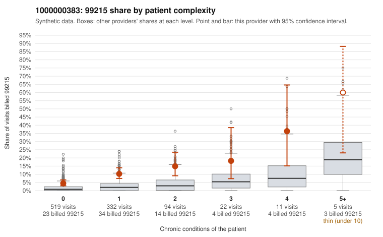

# 1000000383: Elevated 99215 billing concentrated on low-complexity patients is consistent with upcoding risk, but documentation is far too thin to confirm or rule it out.

**Leaning (advisory):** Inconclusive

## Why

1000000383 billed 99215 on 8.3% of 983 claims against an expected 1.7% given patient complexity (risk-adjusted score 5.72; plain z-score vs peers 0.71). 70% of this provider's 99215 claims were on patients with 0 or 1 chronic conditions. Records came back for 18 claims. Of 2 documented 99215 claims, 1 (50%) were documented below the billed level, against 14% for the comparison providers. 1 of 7 notes claiming moderate-or-higher data reviewed had no lab or test line on the claim. The billing pattern itself points toward concern. Most of this provider's 99215 claims fall on patients with zero or one chronic condition, and the sampled low-complexity 99215s (e.g., C0186509 and C0186807 for back pain, C0186853 and C0186900 for Z09 follow-up, C0187009 for rash) carry diagnoses that do not obviously support high-complexity visits. The 99215 share also runs above the all-provider rate in every complexity band, not just among sicker patients, and 99214 is the dominant code overall. The documentation cannot settle the question: only 2 documented 99215 claims came back, one unsupported (C0186699, moderate MDM) and one supported (C0186578, high MDM), and the single data-reviewed note lacking a lab line is weak evidence at most. The low plain peer z-score is ambiguous and may reflect a peer group that also bills high, so a reviewer should first request records targeted at the low-complexity 99215 claims listed and check whether the documented MDM and time support the billed level. Examples: C0186699: billed 99215; documented MDM level moderate, 34 minutes. C0186444: billed 99215, patient aged 46 with 1 chronic condition(s) (hypertension). C0186509: billed 99215, patient aged 56 with 0 chronic condition(s).

## Evidence chart

## Cited claims

`C0186699`, `C0186444`, `C0186509`

## Suggested next steps

- Request records for a larger sample of this provider's 99214 and 99215 claims; what came back is too thin to judge.
- Re-screen the provider once the records arrive.

---
Citations checked: 3/3 valid. Synthetic data. The leaning is advisory; the flag comes from the statistical screen, and no clinical documentation is available beyond the sampled records-review facts shown in the packet.
