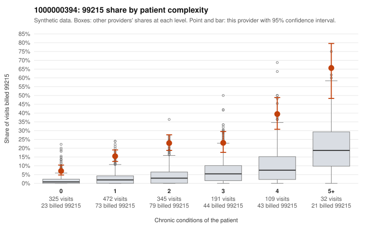

# 1000000394: Provider 1000000394 bills 99215 well above risk-adjusted expectation in every complexity stratum, including many 0-1 condition visits, but documentation is too thin to confirm or refute upcoding.

**Leaning (advisory):** Inconclusive

## Why

1000000394 billed 99215 on 19.2% of 1,474 claims against an expected 3.0% given patient complexity (risk-adjusted score 13.35; plain z-score vs peers 2.86). 34% of this provider's 99215 claims were on patients with 0 or 1 chronic conditions. Records came back for 17 claims. Of 1 documented 99215 claims, 0 (0%) were documented below the billed level, against 14% for the comparison providers. 1 of 12 notes claiming moderate-or-higher data reviewed had no lab or test line on the claim. The billing pattern leans toward concern. The excess 99215 share holds across every chronic-condition band in the by-complexity table, not only among sicker patients. A third of the provider's 99215s fall on patients with 0 or 1 conditions, and the sampled low-complexity claims carry minor diagnoses that rarely warrant high-complexity MDM, such as upper respiratory infection, UTI, rash or follow-up exam (e.g., C0195484, C0196828, C0196127, C0196139). The sampled high-complexity 99215s (e.g., C0196494, C0196541) look clinically plausible, so part of the panel may genuinely be complex. The records review cannot settle the question: only one documented 99215 came back (C0196708, supported), and the single data-reviewed note without a lab line is weak evidence at most. A reviewer should first request charts specifically for the low-complexity 99215s cited, to test whether the MDM and minutes support the billed level, before drawing any conclusion. Examples: C0195397: billed 99215, patient aged 37 with 0 chronic condition(s). C0195411: billed 99215, patient aged 49 with 1 chronic condition(s) (hypertension).

## Evidence chart

## Cited claims

`C0195397`, `C0195411`

## Suggested next steps

- Request records for a larger sample of this provider's 99214 and 99215 claims; what came back is too thin to judge.
- Re-screen the provider once the records arrive.

---
Citations checked: 2/2 valid. Synthetic data. The leaning is advisory; the flag comes from the statistical screen, and no clinical documentation is available beyond the sampled records-review facts shown in the packet.
