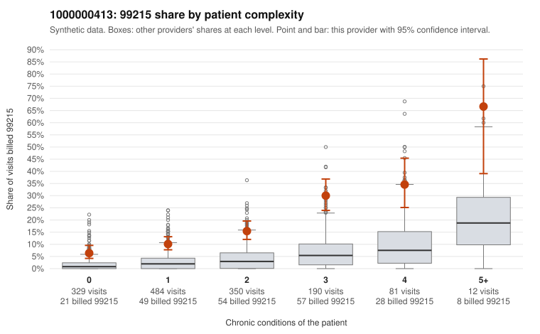

# 1000000413: Provider 1000000413 bills 99215 well above the risk-adjusted expectation in every complexity band, including healthy patients, but no 99215 charts came back to confirm or refute it.

**Leaning (advisory):** Inconclusive

## Why

1000000413 billed 99215 on 15.0% of 1,446 claims against an expected 2.7% given patient complexity (risk-adjusted score 10.46; plain z-score vs peers 2.03). 32% of this provider's 99215 claims were on patients with 0 or 1 chronic conditions. Records came back for 16 claims. No documented 99215 claims came back. 2 of 12 notes claiming moderate-or-higher data reviewed had no lab or test line on the claim. The elevation is not explained by panel acuity: 99215 share runs roughly three times the all-provider rate in every complexity band, and about a third of 99215s fall on patients with 0–1 conditions. Sampled examples such as C0204920 (Z09 follow-up), C0205690 and C0206083 (J06.9 upper respiratory infection) and C0205584 (M54.50 low back pain) are presentations that rarely support high-complexity decision making. That said, the high-complexity samples (for example C0205190 and C0206327) look plausibly appropriate, and the documentation is too thin to judge: only 16 charts returned, all billed 99214, and none billed 99215. The 2 of 16 99214 notes documented below the billed level (C0204835, C0205104) and the 2 moderate-or-higher data-reviewed notes with no lab or test line on the claim are weak signals worth noting, not proof. The reviewer's first step should be a targeted records request for 99215 claims on low-complexity patients, starting with the sampled 0-condition visits, to test whether MDM or time supports the billed level. Examples: C0204835: billed 99214; documented MDM level low, minutes not recorded. C0205104: billed 99214; documented MDM level low, minutes not recorded. C0204831: billed 99215, patient aged 55 with 1 chronic condition(s) (hyperlipidemia). C0204852: billed 99215, patient aged 55 with 1 chronic condition(s) (depression).

## Evidence chart

## Cited claims

`C0204835`, `C0205104`, `C0204831`, `C0204852`

## Suggested next steps

- Request records for a larger sample of this provider's 99214 and 99215 claims; what came back is too thin to judge.
- Re-screen the provider once the records arrive.

---
Citations checked: 4/4 valid. Synthetic data. The leaning is advisory; the flag comes from the statistical screen, and no clinical documentation is available beyond the sampled records-review facts shown in the packet.
