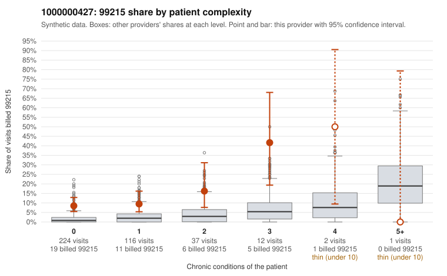

# 1000000427: Provider 1000000427 bills 99215 far above risk-adjusted expectation, mostly on low-complexity patients, but no 99215 records came back to confirm or refute support.

**Leaning (advisory):** Inconclusive

## Why

1000000427 billed 99215 on 10.7% of 392 claims against an expected 1.6% given patient complexity (risk-adjusted score 5.04; plain z-score vs peers 1.18). 71% of this provider's 99215 claims were on patients with 0 or 1 chronic conditions. Records came back for 15 claims. No documented 99215 claims came back. 0 of 10 notes claiming moderate-or-higher data reviewed had no lab or test line on the claim. The claim-level pattern is concerning. Most 99215s fall on patients with 0 or 1 chronic conditions, and sampled examples carry routine diagnoses such as upper respiratory infection (C0213904, C0213950), follow-up encounters (C0213879, C0214022) and uncomplicated UTI (C0213988, C0214258), which is the profile consistent with upcoding rather than a sicker panel. Against that, the 15 returned charts are all 99213 and 99214 claims, they all supported the billed level, and none of the notes claiming moderate-or-higher data review lacked a lab or test line. That gives no direct evidence of inflated documentation, but it also says nothing about the 99215 claims at issue. Because documentation is too thin to judge the highest-level visits, the leaning stays inconclusive despite the billing pattern. A reviewer should first request charts for the low-complexity 99215 claims listed, prioritizing simple-diagnosis visits like C0213904 and C0214187, and check whether documented MDM and time actually reach the 99215 level. Examples: C0213866: billed 99215, patient aged 38 with 1 chronic condition(s) (type 2 diabetes). C0213879: billed 99215, patient aged 44 with 0 chronic condition(s).

## Evidence chart

## Cited claims

`C0213866`, `C0213879`

## Suggested next steps

- Request records for a larger sample of this provider's 99214 and 99215 claims; what came back is too thin to judge.
- Re-screen the provider once the records arrive.

---
Citations checked: 2/2 valid. Synthetic data. The leaning is advisory; the flag comes from the statistical screen, and no clinical documentation is available beyond the sampled records-review facts shown in the packet.
