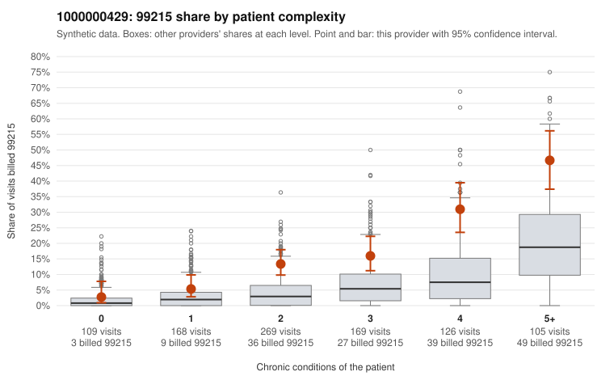

# 1000000429: Provider 1000000429 bills 99215 well above risk-adjusted expectation, and the excess appears in every complexity tier, but records are too thin to tell upcoding from a complex panel.

**Leaning (advisory):** Inconclusive

## Why

1000000429 billed 99215 on 17.2% of 946 claims against an expected 4.9% given patient complexity (risk-adjusted score 6.41; plain z-score vs peers 2.47). 7% of this provider's 99215 claims were on patients with 0 or 1 chronic conditions. Records came back for 18 claims. Of 2 documented 99215 claims, 0 (0%) were documented below the billed level, against 14% for the comparison providers. 2 of 17 notes claiming moderate-or-higher data reviewed had no lab or test line on the claim. Most of this provider's 99215 claims fall on multi-morbid patients, such as C0214550 and C0214929, which fits a sicker panel. However, the by-complexity table shows their 99215 share running roughly two to three times the all-provider share within every condition tier, so the elevation persists after accounting for complexity rather than being explained by it. The small low-complexity slice, for example C0214517 (rash, no chronic conditions) and C0214692 and C0214908 (back pain only), is where billed intensity looks hardest to justify. Documentation cannot settle the question: only two 99215 charts came back, and both (C0215058, C0215094) supported the billed level. The two moderate-or-higher data-reviewed notes with no lab or test line on the claim are weak evidence at most. A reviewer should first request charts for the sampled low-complexity 99215 claims and a larger random set of 99214 and 99215 claims, since 99214 dominates the mix, to see whether the documented MDM holds up at volume. Examples: C0214768: billed 99213; documented MDM level straightforward, minutes not recorded. C0214517: billed 99215, patient aged 34 with 0 chronic condition(s). C0214551: billed 99215, patient aged 37 with 1 chronic condition(s) (hypertension).

## Evidence chart

## Cited claims

`C0214768`, `C0214517`, `C0214551`

## Suggested next steps

- Request records for a larger sample of this provider's 99214 and 99215 claims; what came back is too thin to judge.
- Re-screen the provider once the records arrive.

---
Citations checked: 3/3 valid. Synthetic data. The leaning is advisory; the flag comes from the statistical screen, and no clinical documentation is available beyond the sampled records-review facts shown in the packet.
