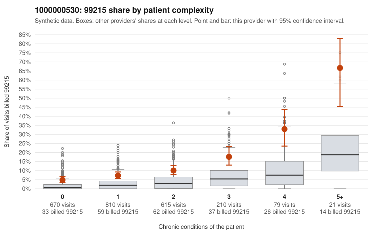

# 1000000530: Provider 1000000530's 99215 rate stays elevated even among patients with no chronic conditions, a claims pattern consistent with upcoding, but documentation is too thin to confirm it.

**Leaning (advisory):** Pattern consistent with upcoding

## Why

1000000530 billed 99215 on 9.6% of 2,405 claims against an expected 2.4% given patient complexity (risk-adjusted score 8.24; plain z-score vs peers 0.96). 40% of this provider's 99215 claims were on patients with 0 or 1 chronic conditions. Records came back for 15 claims. No documented 99215 claims came back. 1 of 11 notes claiming moderate-or-higher data reviewed had no lab or test line on the claim. The sicker-panel explanation is weakened because the elevated 99215 share holds in every complexity stratum, not just the complex ones, and the sampled low-complexity 99215s include routine presentations such as upper respiratory infection (C0259752, C0260660, C0260846) and rash (C0259580). These are hard to square with high-complexity decision-making. The sampled high-complexity 99215s look plausible, and the modest peer z-score suggests the peer group may also bill high, which keeps some ambiguity. Documentation cannot settle the question: no 99215 charts came back, and the 99214 mismatches (C0259975, C0260481, both documented as low MDM) come from too few records to read as a pattern. A reviewer should first pursue a targeted records request for the low-complexity 99215 claims listed, starting with the acute upper respiratory infection and rash visits, and compare documented MDM and time against the billed level. Examples: C0259975: billed 99214; documented MDM level low, 27 minutes. C0260481: billed 99214; documented MDM level low, 21 minutes. C0259371: billed 99215, patient aged 60 with 0 chronic condition(s). C0259469: billed 99215, patient aged 30 with 1 chronic condition(s) (type 2 diabetes). C0259544: billed 99215, patient aged 30 with 1 chronic condition(s) (type 2 diabetes).

## Evidence chart

## Cited claims

`C0259975`, `C0260481`, `C0259371`, `C0259469`, `C0259544`

## Suggested next steps

- Request the full records for the cited claims and have a certified coder re-score each against current E/M documentation rules (medical decision making or total time).
- If the re-scoring confirms the pattern, use the sampling plan in the recovery packet to review a statistical sample of this provider's 99215 claims.
- Check whether notes for the cited claims look copied forward, and whether documented minutes repeat from visit to visit.

---
Citations checked: 5/5 valid. Synthetic data. The leaning is advisory; the flag comes from the statistical screen, and no clinical documentation is available beyond the sampled records-review facts shown in the packet.
