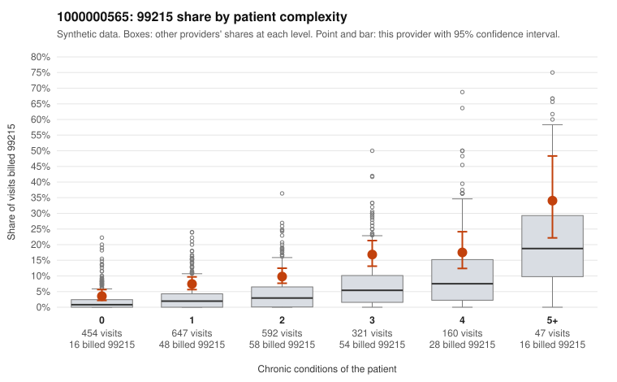

# 1000000565: Provider 1000000565 bills 99215 above expectation in every complexity tier, including simple acute visits, but the few charts returned support the level billed, so the documentation is too thin to decide.

**Leaning (advisory):** Inconclusive

## Why

1000000565 billed 99215 on 9.9% of 2,221 claims against an expected 3.1% given patient complexity (risk-adjusted score 6.75; plain z-score vs peers 1.02). 29% of this provider's 99215 claims were on patients with 0 or 1 chronic conditions. Records came back for 18 claims. Of 2 documented 99215 claims, 0 (0%) were documented below the billed level, against 14% for the comparison providers. 0 of 15 notes claiming moderate-or-higher data reviewed had no lab or test line on the claim. The elevation is not confined to sicker patients. The 99215 share runs roughly double the all-provider rate in every condition-count tier, and most other visits are billed at 99214, which looks more like a practice-wide coding habit than a complex panel. The low-complexity sample includes 99215s for routine acute problems on patients with no chronic conditions, such as upper respiratory infection (C0278247, C0279743), UTI (C0278238 is a rash; C0279630, C0278859 and C0279987 are UTIs) and low back pain (C0280178), which are hard to square with high-level MDM. Weighing against this, both documented 99215s (C0279632, C0279705) support high MDM, no documented claim fell below its billed level, and every note claiming moderate-or-higher data reviewed had a matching lab or test line. Two charts out of more than two hundred 99215s cannot confirm or clear the pattern, so a reviewer should first request targeted records for the sampled low-complexity 99215 claims, and check whether those notes show genuine high-complexity decision-making or templated or cloned language. Examples: C0278238: billed 99215, patient aged 54 with 0 chronic condition(s). C0278247: billed 99215, patient aged 56 with 0 chronic condition(s).

## Evidence chart

## Cited claims

`C0278238`, `C0278247`

## Suggested next steps

- Request records for a larger sample of this provider's 99214 and 99215 claims; what came back is too thin to judge.
- Re-screen the provider once the records arrive.

---
Citations checked: 2/2 valid. Synthetic data. The leaning is advisory; the flag comes from the statistical screen, and no clinical documentation is available beyond the sampled records-review facts shown in the packet.
