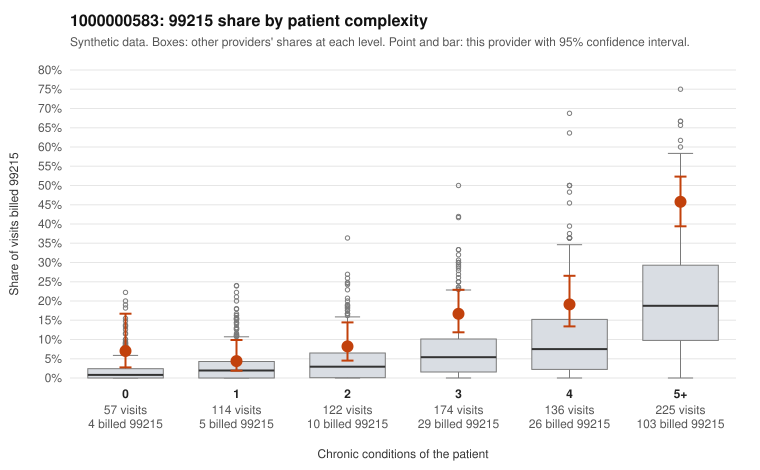

# 1000000583: 1000000583: documented 99215 claims mostly support the level billed (0% below)

**Leaning (advisory):** Pattern consistent with a high-acuity panel

## Why

1000000583 billed 99215 on 21.4% of 828 claims against an expected 7.4% given patient complexity (risk-adjusted score 5.60; plain z-score vs peers 3.29). 5% of this provider's 99215 claims were on patients with 0 or 1 chronic conditions. Records came back for 21 claims. Of 6 documented 99215 claims, 0 (0%) were documented below the billed level, against 14% for the comparison providers. 2 of 15 notes claiming moderate-or-higher data reviewed had no lab or test line on the claim. This pattern is consistent with a high-acuity panel. The sampled documentation supports the billed level. Examples: C0287607: billed 99215; documented MDM level high, minutes not recorded. C0287676: billed 99215; documented MDM level high, 42 minutes. C0287826: billed 99215; documented MDM level high, 40 minutes. C0287581: billed 99215, patient aged 58 with 4 chronic condition(s) (type 2 diabetes;obesity;hypertension;heart failure). C0287620: billed 99215, patient aged 77 with 4 chronic condition(s) (type 2 diabetes;obesity;depression;hypertension).

## Evidence chart

## Cited claims

`C0287607`, `C0287676`, `C0287826`, `C0287581`, `C0287620`

## Suggested next steps

- Do not pursue recovery on this evidence: the documentation returned supports the level billed.
- Revisit if the provider's 99215 share keeps rising against peers, or if a larger records sample shows unsupported claims.

---
Citations checked: 5/5 valid. Synthetic data. The leaning is advisory; the flag comes from the statistical screen, and no clinical documentation is available beyond the sampled records-review facts shown in the packet.
