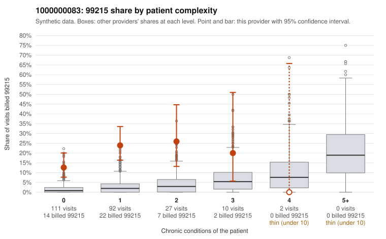

# Payment Integrity dossier: 1000000083

> Draft for human review. Statistical and records-sample evidence only; not a finding. Compliance or legal review is needed before any provider contact, notice or recoupment.

## Provider overview

| | |
|---|---|
| Specialty / state | Family Practice, GA (synthetic) |
| Claims / patients | 242 / 117 |
| Billed mix (99211 to 99215) | 2 / 0 / 53 / 142 / 45 |
| 99215 share | 18.6% |
| Expected 99215 share given patient complexity | 1.8% |
| Screen scores | z vs peers 2.74; risk-adjusted 7.17; flagged by suspicion>=5 |

## Case summary (advisory)

**Provider 1000000083 bills 99215 far above the risk-adjusted expectation, concentrated on patients with few or no chronic conditions, but records are too thin to confirm or refute the billed levels.**

Leaning: pattern consistent with upcoding. Citations checked: 4/4 valid.

1000000083 billed 99215 on 18.6% of 242 claims against an expected 1.8% given patient complexity (risk-adjusted score 7.17; plain z-score vs peers 2.74). 80% of this provider's 99215 claims were on patients with 0 or 1 chronic conditions. Records came back for 13 claims. Of 2 documented 99215 claims, 0 (0%) were documented below the billed level, against 14% for the comparison providers. 2 of 12 notes claiming moderate-or-higher data reviewed had no lab or test line on the claim. The claims pattern points away from a sicker panel. Most 99215 visits fall on patients with zero or one chronic condition, and the sampled examples carry routine diagnoses such as Z09 follow-up, J06.9 upper respiratory infection, R10.9 abdominal pain and M54.50 low back pain. The excess is sharpest in the 0- and 1-condition rows of the complexity table, and no high-complexity 99215 claims appear in the sample. The documentation does not settle the question: only two 99215 claims had records. Both supported the billed level, including low-complexity claim C0036483 (type 2 diabetes only, documented high MDM), so the leaning rests on the billing distribution rather than on chart findings. The two moderate-plus data-reviewed notes without a lab or test line are weak evidence of possible note inflation, not proof. A reviewer should first request charts for a targeted sample of the low-complexity 99215 claims listed (for example C0036277, C0036402 and C0036459) to check whether documented MDM and time support level 5. The reviewer should also check whether the supported notes look templated or cloned. Examples: C0036297: billed 99214; documented MDM level low, 16 minutes. C0036249: billed 99215, patient aged 42 with 1 chronic condition(s) (osteoarthritis). C0036277: billed 99215, patient aged 44 with 0 chronic condition(s). C0036286: billed 99215, patient aged 61 with 1 chronic condition(s) (type 2 diabetes).

## Evidence chart

## Records-review sample so far

Documentation is on file for 13 claims (5% of this provider's claims).

| Billed | Documented | Documentation below billed level | Rate | All-provider rate |
|---|---|---|---|---|
| 99213 | 1 | 0 | 0.0% | 5.0% |
| 99214 | 10 | 1 | 10.0% | 3.0% |
| 99215 | 2 | 0 | 0.0% | 14.3% |

## Recommended next steps for Payment Integrity

1. Request records for the sampled claims in `record_request_list.csv` (28 claims across 99215).
2. Review the records against E/M documentation rules and record the supported level for each claim.
3. Run the overpayment estimator on the reviewed sample (`sampling_plan.md` explains how).
4. Notice, appeal rights, recoupment, education or corrective action, and any referral are decisions for the PI team, compliance and counsel. Nothing here drafts those.

Suggested follow-ups from the case summary:

- Request the full records for the cited claims and have a certified coder re-score each against current E/M documentation rules (medical decision making or total time).
- If the re-scoring confirms the pattern, use the sampling plan in the recovery packet to review a statistical sample of this provider's 99215 claims.
- Check whether notes for the cited claims look copied forward, and whether documented minutes repeat from visit to visit.

## Limits

- Synthetic data; no real claims or providers.
- The leaning is advisory. The flag comes from the statistical screen; the summary explains it.
- The records-review sample is partial and was simulated for this project.
- Allowed amounts are GA Family Practice averages from a public CMS file, not this provider's actual payments.
