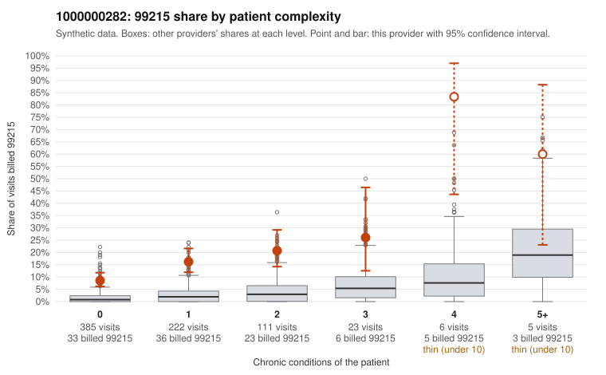

# Payment Integrity dossier: 1000000282

> Draft for human review. Statistical and records-sample evidence only; not a finding. Compliance or legal review is needed before any provider contact, notice or recoupment.

## Provider overview

| | |
|---|---|
| Specialty / state | Family Practice, GA (synthetic) |
| Claims / patients | 752 / 362 |
| Billed mix (99211 to 99215) | 3 / 4 / 134 / 505 / 106 |
| 99215 share | 14.1% |
| Expected 99215 share given patient complexity | 1.8% |
| Screen scores | z vs peers 1.85; risk-adjusted 9.12; flagged by suspicion>=5 |

## Case summary (advisory)

**Provider 1000000282 bills 99215 far above risk-adjusted expectation, mostly on patients with 0 or 1 chronic conditions, and the few returned charts are too thin to confirm or refute the billed levels.**

Leaning: pattern consistent with upcoding. Citations checked: 3/3 valid.

1000000282 billed 99215 on 14.1% of 752 claims against an expected 1.8% given patient complexity (risk-adjusted score 9.12; plain z-score vs peers 1.85). 65% of this provider's 99215 claims were on patients with 0 or 1 chronic conditions. Records came back for 17 claims. Of 3 documented 99215 claims, 0 (0%) were documented below the billed level, against 14% for the comparison providers. 1 of 10 notes claiming moderate-or-higher data reviewed had no lab or test line on the claim. The billing pattern leans toward upcoding. The excess 99215 use is not explained by panel acuity: most 99215s fall on patients with no or one chronic condition. The sampled low-complexity claims show simple presentations billed at the top level, such as rash (C0136469, C0136499), low back pain (C0136443, C0136672) and urinary infection (C0136697, C0136972). The provider also bills 99214 heavily, including on zero-condition patients (C0136609, C0136872). The main ambiguity is documentation: only 3 documented 99215 claims came back, all supported at high MDM, and the one cloned-note signal (moderate-plus data reviewed with no lab line) is weak. The charts therefore neither confirm nor rule out inflation. A reviewer should first request charts for the sampled low-complexity 99215 claims and check whether they show high-complexity decision-making and the time to support it, or templated or inflated notes. Examples: C0136421: billed 99215, patient aged 53 with 1 chronic condition(s) (asthma). C0136443: billed 99215, patient aged 19 with 0 chronic condition(s). C0136469: billed 99215, patient aged 81 with 0 chronic condition(s).

## Evidence chart

## Records-review sample so far

Documentation is on file for 17 claims (2% of this provider's claims).

| Billed | Documented | Documentation below billed level | Rate | All-provider rate |
|---|---|---|---|---|
| 99213 | 3 | 0 | 0.0% | 5.0% |
| 99214 | 11 | 0 | 0.0% | 3.0% |
| 99215 | 3 | 0 | 0.0% | 14.3% |

## Recommended next steps for Payment Integrity

1. Request records for the sampled claims in `record_request_list.csv` (42 claims across 99215).
2. Review the records against E/M documentation rules and record the supported level for each claim.
3. Run the overpayment estimator on the reviewed sample (`sampling_plan.md` explains how).
4. Notice, appeal rights, recoupment, education or corrective action, and any referral are decisions for the PI team, compliance and counsel. Nothing here drafts those.

Suggested follow-ups from the case summary:

- Request the full records for the cited claims and have a certified coder re-score each against current E/M documentation rules (medical decision making or total time).
- If the re-scoring confirms the pattern, use the sampling plan in the recovery packet to review a statistical sample of this provider's 99215 claims.
- Check whether notes for the cited claims look copied forward, and whether documented minutes repeat from visit to visit.

## Limits

- Synthetic data; no real claims or providers.
- The leaning is advisory. The flag comes from the statistical screen; the summary explains it.
- The records-review sample is partial and was simulated for this project.
- Allowed amounts are GA Family Practice averages from a public CMS file, not this provider's actual payments.
