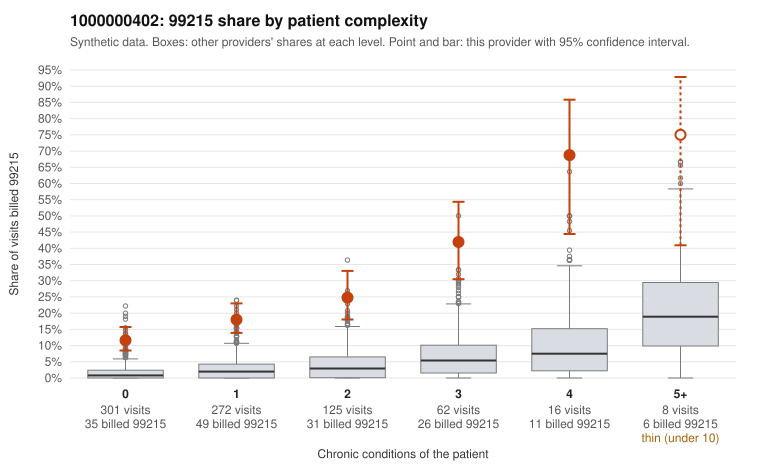

# Payment Integrity dossier: 1000000402

> Draft for human review. Statistical and records-sample evidence only; not a finding. Compliance or legal review is needed before any provider contact, notice or recoupment.

## Provider overview

| | |
|---|---|
| Specialty / state | Family Practice, GA (synthetic) |
| Claims / patients | 784 / 394 |
| Billed mix (99211 to 99215) | 7 / 4 / 150 / 465 / 158 |
| 99215 share | 20.2% |
| Expected 99215 share given patient complexity | 2.2% |
| Screen scores | z vs peers 3.05; risk-adjusted 12.54; flagged by suspicion>=5 |

## Case summary (advisory)

**Elevated 99215 billing persists at every complexity level, including routine acute visits on patients with no chronic conditions, but the single documented 99215 is too thin to confirm or refute upcoding.**

Leaning: pattern consistent with upcoding. Citations checked: 4/4 valid.

1000000402 billed 99215 on 20.2% of 784 claims against an expected 2.2% given patient complexity (risk-adjusted score 12.54; plain z-score vs peers 3.05). 53% of this provider's 99215 claims were on patients with 0 or 1 chronic conditions. Records came back for 17 claims. Of 1 documented 99215 claims, 0 (0%) were documented below the billed level, against 14% for the comparison providers. 1 of 14 notes claiming moderate-or-higher data reviewed had no lab or test line on the claim. The claims pattern does not look like a sicker panel. The excess 99215 share appears in every complexity stratum, not just among multimorbid patients, and about half of the 99215s fall on patients with 0–1 conditions. The sampled low-complexity 99215s are mostly routine problems: upper respiratory infections (C0199451, C0199894), UTIs (C0199334, C0199875), low back pain (C0199115-type M54.50 claims such as C0199700) and follow-up visits (C0199556, C0199579). Complex-patient 99215s such as C0200093 and C0199962 are plausible, but they do not explain the excess. The documentation cannot settle the question: records came back for only a small fraction of claims and cover just one 99215. That claim, C0199784, is an 18-year-old with an upper respiratory infection documented as high MDM with no time recorded, which is itself worth scrutiny as a possibly inflated or templated note rather than reassurance. A reviewer should first request charts for the sampled low-complexity 99215 claims listed above and check whether the MDM elements, time and any tests ordered genuinely support high complexity for these routine diagnoses. Examples: C0199633: billed 99214; documented MDM level low, 21 minutes. C0199334: billed 99215, patient aged 53 with 0 chronic condition(s). C0199437: billed 99215, patient aged 44 with 0 chronic condition(s). C0199451: billed 99215, patient aged 28 with 0 chronic condition(s).

## Evidence chart

## Records-review sample so far

Documentation is on file for 17 claims (2% of this provider's claims).

| Billed | Documented | Documentation below billed level | Rate | All-provider rate |
|---|---|---|---|---|
| 99213 | 3 | 0 | 0.0% | 5.0% |
| 99214 | 13 | 1 | 7.7% | 3.0% |
| 99215 | 1 | 0 | 0.0% | 14.3% |

## Recommended next steps for Payment Integrity

1. Request records for the sampled claims in `record_request_list.csv` (48 claims across 99215).
2. Review the records against E/M documentation rules and record the supported level for each claim.
3. Run the overpayment estimator on the reviewed sample (`sampling_plan.md` explains how).
4. Notice, appeal rights, recoupment, education or corrective action, and any referral are decisions for the PI team, compliance and counsel. Nothing here drafts those.

Suggested follow-ups from the case summary:

- Request the full records for the cited claims and have a certified coder re-score each against current E/M documentation rules (medical decision making or total time).
- If the re-scoring confirms the pattern, use the sampling plan in the recovery packet to review a statistical sample of this provider's 99215 claims.
- Check whether notes for the cited claims look copied forward, and whether documented minutes repeat from visit to visit.

## Limits

- Synthetic data; no real claims or providers.
- The leaning is advisory. The flag comes from the statistical screen; the summary explains it.
- The records-review sample is partial and was simulated for this project.
- Allowed amounts are GA Family Practice averages from a public CMS file, not this provider's actual payments.
