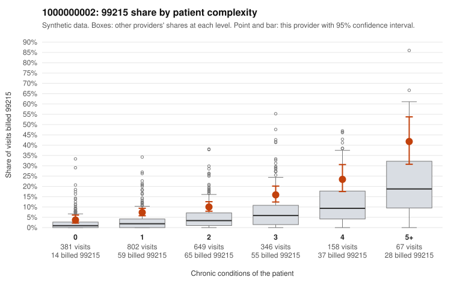

# 1000000002: Provider 1000000002 bills 99215 well above expectation in every complexity tier, including simple acute visits, but the records came back too thin to confirm or rule out upcoding.

**Leaning (advisory):** Inconclusive

## Why

1000000002 billed 99215 on 10.7% of 2,403 claims against an expected 3.3% given patient complexity (risk-adjusted score 7.28; plain z-score vs peers 1.10). 28% of this provider's 99215 claims were on patients with 0 or 1 chronic conditions. Records came back for 18 claims. Of 2 documented 99215 claims, 0 (0%) were documented below the billed level, against 0% for the comparison providers. 0 of 12 notes claiming moderate-or-higher data reviewed had no lab or test line on the claim. The excess 99215 billing is not confined to sicker patients; it runs at roughly double the all-provider share in every complexity tier, including patients with no chronic conditions. Because risk adjustment already accounts for panel mix, this points more toward a coding habit than a sicker panel, and the low-complexity sample includes 99215s for routine-looking problems such as URI (C0001473, C0002999), UTI (C0000809), back pain (C0000652) and follow-up visits (C0001862). The records review does not confirm this. Only two documented 99215 claims exist, both supported at high MDM, the few lower-level mismatches are too small to weigh, and there is no sign of inflated data-reviewed notes, so the documentation is too thin to judge. A reviewer should first request charts for the sampled low-complexity 99215 claims, starting with acute-only diagnoses, and compare C0001661 against C0001959, which the same hypertension patient received as 99215 and 99213 respectively. Examples: C0000733: billed 99214; documented MDM level low, 26 minutes. C0001058: billed 99213; documented MDM level straightforward, minutes not recorded. C0000619: billed 99215, patient aged 18 with 0 chronic condition(s). C0000652: billed 99215, patient aged 23 with 0 chronic condition(s).

## Evidence chart

## Cited claims

`C0000733`, `C0001058`, `C0000619`, `C0000652`

## Suggested next steps

- Request records for a larger sample of this provider's 99214 and 99215 claims; what came back is too thin to judge.
- Re-screen the provider once the records arrive.

---
Citations checked: 4/4 valid. Synthetic data. The leaning is advisory; the flag comes from the statistical screen, and no clinical documentation is available beyond the sampled records-review facts shown in the packet.
