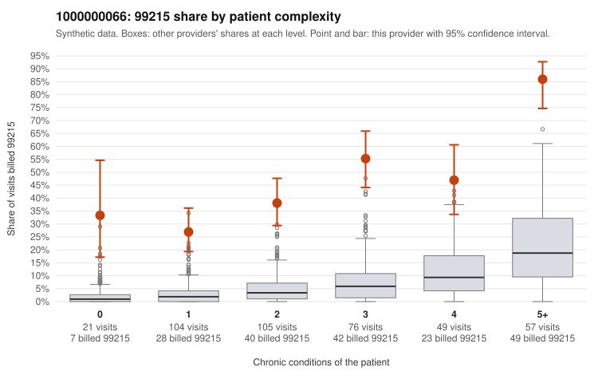

# 1000000066: Provider 1000000066's 99215 rate is elevated in every complexity band, including patients with no chronic conditions; the few charts reviewed support the billed level but are too thin to settle the question.

**Leaning (advisory):** Inconclusive

## Why

1000000066 billed 99215 on 45.9% of 412 claims against an expected 5.2% given patient complexity (risk-adjusted score 13.41; plain z-score vs peers 7.74). 19% of this provider's 99215 claims were on patients with 0 or 1 chronic conditions. Records came back for 15 claims. Of 7 documented 99215 claims, 0 (0%) were documented below the billed level, against 0% for the comparison providers. 1 of 12 notes claiming moderate-or-higher data reviewed had no lab or test line on the claim. A sicker panel does not explain the excess: the by-complexity table shows the 99215 share far above the all-provider share in every band, not only among 5+ condition patients. The sampled low-complexity 99215s include visits such as C0029570 and C0029726, which are 0-condition patients with only an upper respiratory infection code. Those visits are where the concern sits. Against that, all 7 documented 99215 claims (e.g., C0029513, C0029567) were supported at high MDM, and only 1 of 12 moderate-plus data-reviewed notes lacked a lab or test line. That is weak, not meaningful, evidence of inflated notes, but records cover only a small share of claims and none of the cited low-complexity 99215s, so documentation cannot yet confirm or rule out upcoding. A reviewer should first request charts for the low-complexity 99215 claims listed in the packet, prioritizing the 0-condition acute visits, and check whether the documented MDM and time hold up and whether notes look templated or cloned. Examples: C0029532: billed 99214; documented MDM level low, minutes not recorded. C0029519: billed 99215, patient aged 57 with 1 chronic condition(s) (type 2 diabetes). C0029537: billed 99215, patient aged 36 with 1 chronic condition(s) (osteoarthritis).

## Evidence chart

## Cited claims

`C0029532`, `C0029519`, `C0029537`

## Suggested next steps

- Request records for a larger sample of this provider's 99214 and 99215 claims; what came back is too thin to judge.
- Re-screen the provider once the records arrive.

---
Citations checked: 3/3 valid. Synthetic data. The leaning is advisory; the flag comes from the statistical screen, and no clinical documentation is available beyond the sampled records-review facts shown in the packet.
