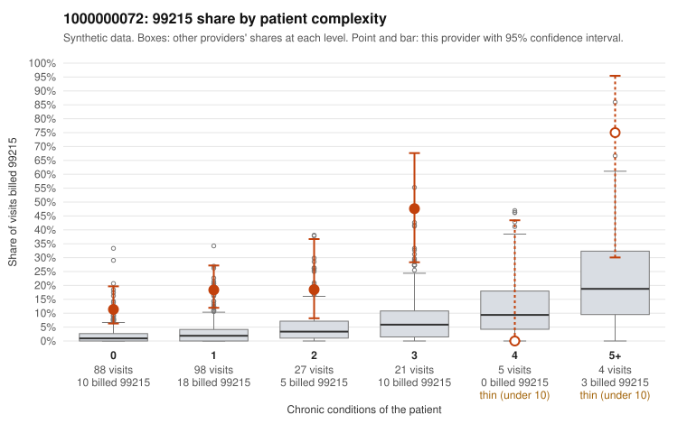

# 1000000072: Provider 1000000072 bills 99215 far above its risk-adjusted expectation, mostly on low-complexity patients, but only one 99215 chart came back, so documentation cannot yet confirm or refute upcoding.

**Leaning (advisory):** Inconclusive

## Why

1000000072 billed 99215 on 18.9% of 243 claims against an expected 2.4% given patient complexity (risk-adjusted score 5.95; plain z-score vs peers 2.65). 61% of this provider's 99215 claims were on patients with 0 or 1 chronic conditions. Records came back for 15 claims. Of 1 documented 99215 claims, 0 (0%) were documented below the billed level, against 0% for the comparison providers. 3 of 7 notes claiming moderate-or-higher data reviewed had no lab or test line on the claim. The billing pattern is the main concern. Most of the excess 99215 volume sits on patients with zero or one chronic condition, and sampled claims such as C0035657, C0035686 and C0035768 show 99215 billed for routine diagnoses like upper respiratory infection (J06.9) or follow-up (Z09), which fits upcoding better than a sicker panel. The documentation is too thin to settle the question: the single documented 99215, C0035812, supported high MDM, yet it was a urinary tract infection visit on a patient with no chronic conditions. The three moderate-or-higher data-reviewed notes with no lab or test line on the claim are weak evidence that notes may be templated or inflated, not proof. A reviewer should first request charts for the low-complexity 99215 claims listed in the packet, then check whether the notes, including C0035812, show genuine high-complexity decision-making or cloned text. Examples: C0035651: billed 99215, patient aged 44 with 1 chronic condition(s) (hypertension). C0035655: billed 99215, patient aged 29 with 1 chronic condition(s) (depression).

## Evidence chart

## Cited claims

`C0035651`, `C0035655`

## Suggested next steps

- Request records for a larger sample of this provider's 99214 and 99215 claims; what came back is too thin to judge.
- Re-screen the provider once the records arrive.

---
Citations checked: 2/2 valid. Synthetic data. The leaning is advisory; the flag comes from the statistical screen, and no clinical documentation is available beyond the sampled records-review facts shown in the packet.
