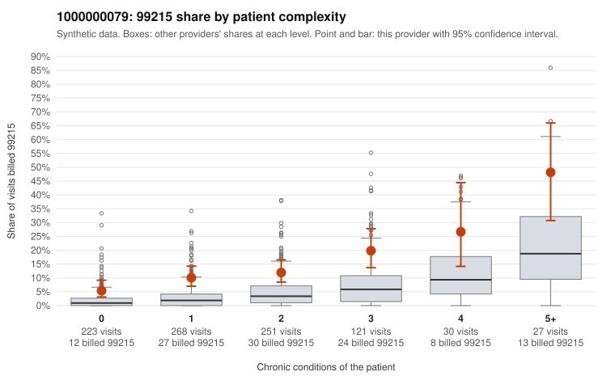

# 1000000079: Provider 1000000079 bills 99215 well above expected in every complexity band, including on sampled low-complexity visits with minor diagnoses, but records for only two 99215 claims came back, too few to judge.

**Leaning (advisory):** Inconclusive

## Why

1000000079 billed 99215 on 12.4% of 920 claims against an expected 3.0% given patient complexity (risk-adjusted score 5.85; plain z-score vs peers 1.42). 34% of this provider's 99215 claims were on patients with 0 or 1 chronic conditions. Records came back for 15 claims. Of 2 documented 99215 claims, 0 (0%) were documented below the billed level, against 0% for the comparison providers. 1 of 9 notes claiming moderate-or-higher data reviewed had no lab or test line on the claim. The excess is not explained by a sicker panel alone. This provider's 99215 share exceeds the all-provider share in every condition band, roughly two to three times higher in each. The sampled low-complexity 99215 claims include visits coded only with follow-up, rash, upper respiratory infection or back pain diagnoses (e.g., C0037858, C0037894, C0038272, C0038550), which is a pattern consistent with upcoding. Against that, both documented 99215 claims (C0038129, C0038635) were supported at high MDM, and only one documented claim overall (C0037804, a 99214) fell below the billed level. Only 1.6% of claims have records, so the documentation is too thin to confirm or rule out upcoding. A reviewer should first request charts for the sampled 99215 claims on patients with no chronic conditions and only minor diagnoses, to see whether high-complexity MDM or time is genuinely documented and not cloned. Examples: C0037804: billed 99214; documented MDM level low, minutes not recorded. C0037800: billed 99215, patient aged 57 with 1 chronic condition(s) (hypertension). C0037828: billed 99215, patient aged 64 with 0 chronic condition(s).

## Evidence chart

## Cited claims

`C0037804`, `C0037800`, `C0037828`

## Suggested next steps

- Request records for a larger sample of this provider's 99214 and 99215 claims; what came back is too thin to judge.
- Re-screen the provider once the records arrive.

---
Citations checked: 3/3 valid. Synthetic data. The leaning is advisory; the flag comes from the statistical screen, and no clinical documentation is available beyond the sampled records-review facts shown in the packet.
