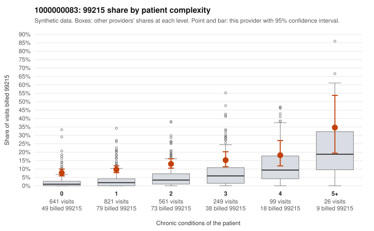

# 1000000083: Provider 1000000083 bills 99215 well above risk-adjusted expectation in every complexity tier, including on many low-complexity patients, but too few charts came back to confirm or rule out upcoding.

**Leaning (advisory):** Inconclusive

## Why

1000000083 billed 99215 on 11.1% of 2,397 claims against an expected 2.7% given patient complexity (risk-adjusted score 9.07; plain z-score vs peers 1.17). 48% of this provider's 99215 claims were on patients with 0 or 1 chronic conditions. Records came back for 11 claims. Of 2 documented 99215 claims, 2 (100%) were documented below the billed level, against 0% for the comparison providers. 1 of 8 notes claiming moderate-or-higher data reviewed had no lab or test line on the claim. The claims pattern is consistent with upcoding rather than a sicker panel. The 99215 share runs well above the all-provider rate in every condition-count band, not just among complex patients, and nearly half of the 99215s fall on patients with 0 or 1 chronic conditions. The sampled low-complexity 99215s include visits coded only for a follow-up (Z09: C0040814, C0040840), an upper respiratory infection (J06.9: C0041377, C0041708) or abdominal pain (R10.9: C0039958, C0040143), which would rarely need high-complexity decision-making. Even so, documentation cannot settle the question: both documented 99215s fell below the billed level (C0040968, and C0042039, an obesity-only patient documented at moderate MDM with 23 minutes), but two charts are far too few to judge. The single note claiming moderate-or-higher data reviewed with no lab or test line on the claim is weak evidence at most. A reviewer should first request records for the low-complexity 99215 claims listed here, starting with the Z09, J06.9 and R10.9 visits, and check whether the documented MDM and time support level 5 or look templated. Examples: C0040968: billed 99215; documented MDM level moderate, minutes not recorded. C0042039: billed 99215, patient aged 36 with 1 chronic condition(s) (obesity); documented MDM level moderate, 23 minutes. C0039940: billed 99215, patient aged 19 with 1 chronic condition(s) (chronic kidney disease). C0039958: billed 99215, patient aged 43 with 0 chronic condition(s).

## Evidence chart

## Cited claims

`C0040968`, `C0042039`, `C0039940`, `C0039958`

## Suggested next steps

- Request records for a larger sample of this provider's 99214 and 99215 claims; what came back is too thin to judge.
- Re-screen the provider once the records arrive.

---
Citations checked: 4/4 valid. Synthetic data. The leaning is advisory; the flag comes from the statistical screen, and no clinical documentation is available beyond the sampled records-review facts shown in the packet.
