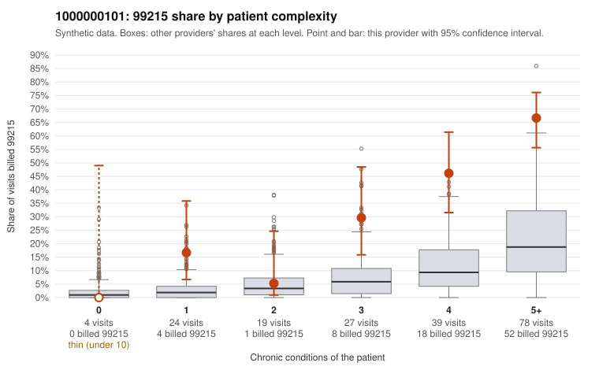

# 1000000101: Provider 1000000101 bills 99215 far above expectation even after risk adjustment, but the 99215s cluster on multi-morbid patients and every documented 99215 was supported, so the pattern is not clearly upcoding.

**Leaning (advisory):** Inconclusive

## Why

1000000101 billed 99215 on 43.5% of 191 claims against an expected 9.0% given patient complexity (risk-adjusted score 5.88; plain z-score vs peers 7.28). 5% of this provider's 99215 claims were on patients with 0 or 1 chronic conditions. Records came back for 14 claims. Of 7 documented 99215 claims, 0 (0%) were documented below the billed level, against 0% for the comparison providers. 0 of 13 notes claiming moderate-or-higher data reviewed had no lab or test line on the claim. Most of this provider's 99215s fall on patients with four or more chronic conditions (for example C0050994, C0051042, C0051115), which fits a sicker panel, and only a few low-complexity 99215s appear (C0050940, C0050955). However, the 99215 share within the 4-condition and 5+ strata is still several times the all-provider share for the same strata, so complexity alone does not explain the excess the risk-adjusted score captures. The records review favors legitimacy: all documented 99215s (e.g., C0050950, C0051048) showed high MDM, and there is no sign of inflated data-reviewed claims without lab lines. That review covers only 7 of 83 99215 claims, so it is too thin to clear the pattern, and two of the supported charts record no minutes. A reviewer should first request a larger sample of 99215 charts, prioritizing the low-complexity claims listed here, and check whether the high-MDM notes show templated or cloned language across patients. Examples: C0050940: billed 99215, patient aged 63 with 1 chronic condition(s) (depression). C0050952: billed 99215, patient aged 34 with 1 chronic condition(s) (depression).

## Evidence chart

## Cited claims

`C0050940`, `C0050952`

## Suggested next steps

- Request records for a larger sample of this provider's 99214 and 99215 claims; what came back is too thin to judge.
- Re-screen the provider once the records arrive.

---
Citations checked: 2/2 valid. Synthetic data. The leaning is advisory; the flag comes from the statistical screen, and no clinical documentation is available beyond the sampled records-review facts shown in the packet.
