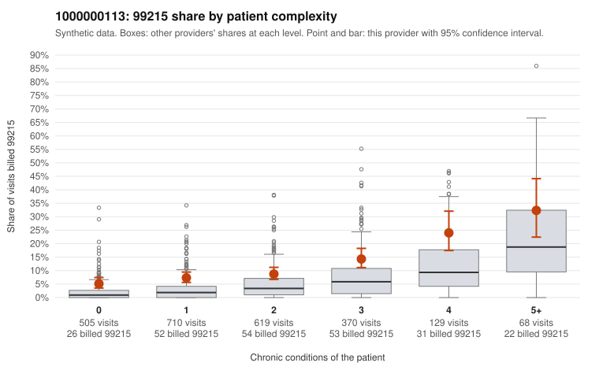

# 1000000113: Provider 1000000113 bills 99215 well above its risk-adjusted expectation in every complexity band, including on low-complexity patients, but documentation is too thin to confirm or rule out upcoding.

**Leaning (advisory):** Inconclusive

## Why

1000000113 billed 99215 on 9.9% of 2,401 claims against an expected 3.2% given patient complexity (risk-adjusted score 6.62; plain z-score vs peers 0.95). 33% of this provider's 99215 claims were on patients with 0 or 1 chronic conditions. Records came back for 13 claims. Of 2 documented 99215 claims, 0 (0%) were documented below the billed level, against 0% for the comparison providers. 0 of 10 notes claiming moderate-or-higher data reviewed had no lab or test line on the claim. The elevated 99215 rate is not explained by panel acuity alone: the by-complexity table shows this provider roughly double the all-provider 99215 share in each band from 0 to 4 conditions. A third of its 99215s fall on patients with 0 or 1 chronic conditions, and sampled examples such as C0055397, C0055603 and C0056336 (acute upper respiratory infection, no chronic conditions) and C0054718 and C0056027 (follow-up visit codes) are the kind of encounters that rarely support high-complexity MDM. Against that, the sampled high-complexity 99215s (e.g., C0054914, C0056072) look plausible. The few records returned show no unsupported levels and no cloned-data signal, but only 2 of them are documented 99215s, so they cannot tip the balance either way. A reviewer should first request charts for the low-complexity 99215 claims listed in the packet, prioritising the acute-only and Z09 visits, and check whether the MDM or time documented there supports level 5. Examples: C0054371: billed 99215, patient aged 54 with 0 chronic condition(s). C0054561: billed 99215, patient aged 55 with 0 chronic condition(s).

## Evidence chart

## Cited claims

`C0054371`, `C0054561`

## Suggested next steps

- Request records for a larger sample of this provider's 99214 and 99215 claims; what came back is too thin to judge.
- Re-screen the provider once the records arrive.

---
Citations checked: 2/2 valid. Synthetic data. The leaning is advisory; the flag comes from the statistical screen, and no clinical documentation is available beyond the sampled records-review facts shown in the packet.
