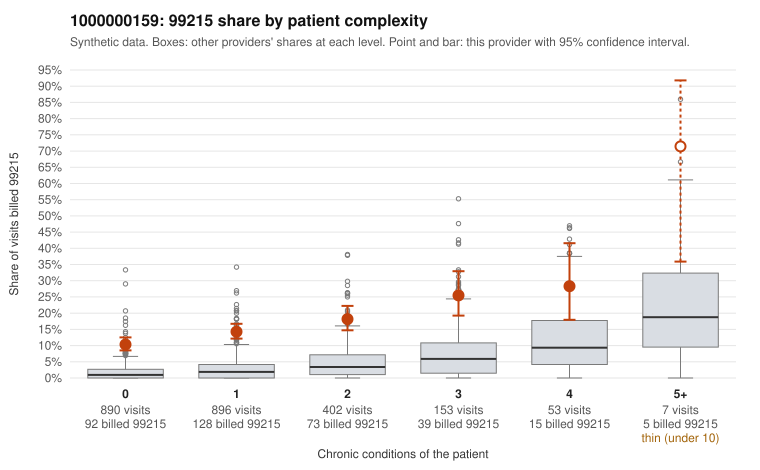

# 1000000159: 1000000159: 4 of 4 documented 99215 claims (100%) are documented below the billed level

**Leaning (advisory):** Pattern consistent with upcoding

## Why

1000000159 billed 99215 on 14.7% of 2,401 claims against an expected 2.2% given patient complexity (risk-adjusted score 14.88; plain z-score vs peers 1.85). 62% of this provider's 99215 claims were on patients with 0 or 1 chronic conditions. Records came back for 21 claims. Of 4 documented 99215 claims, 4 (100%) were documented below the billed level, against 0% for the comparison providers. 0 of 11 notes claiming moderate-or-higher data reviewed had no lab or test line on the claim. This pattern is consistent with upcoding. It is a reason to review the records, not a finding. Examples: C0077537: billed 99215; documented MDM level moderate, minutes not recorded. C0077615: billed 99215; documented MDM level moderate, minutes not recorded. C0078072: billed 99215; documented MDM level moderate, 32 minutes. C0076733: billed 99215, patient aged 44 with 1 chronic condition(s) (asthma). C0076753: billed 99215, patient aged 38 with 1 chronic condition(s) (type 2 diabetes). C0076793: billed 99215, patient aged 49 with 0 chronic condition(s).

## Evidence chart

## Cited claims

`C0077537`, `C0077615`, `C0078072`, `C0076733`, `C0076753`, `C0076793`

## Suggested next steps

- Request the full records for the cited claims and have a certified coder re-score each against current E/M documentation rules (medical decision making or total time).
- If the re-scoring confirms the pattern, use the sampling plan in the recovery packet to review a statistical sample of this provider's 99215 claims.
- Check whether notes for the cited claims look copied forward, and whether documented minutes repeat from visit to visit.

---
Citations checked: 6/6 valid. Synthetic data. The leaning is advisory; the flag comes from the statistical screen, and no clinical documentation is available beyond the sampled records-review facts shown in the packet.
