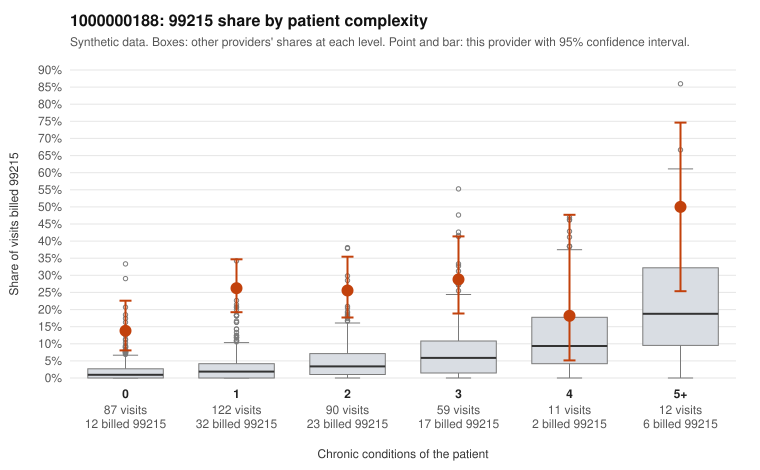

# 1000000188: Provider 1000000188's 99215 share is elevated in every complexity band, including patients with few or no chronic conditions, but the few charts returned all support the billed levels, so documentation is too thin to settle the question.

**Leaning (advisory):** Inconclusive

## Why

1000000188 billed 99215 on 24.1% of 381 claims against an expected 3.1% given patient complexity (risk-adjusted score 8.50; plain z-score vs peers 3.64). 48% of this provider's 99215 claims were on patients with 0 or 1 chronic conditions. Records came back for 16 claims. Of 4 documented 99215 claims, 0 (0%) were documented below the billed level, against 0% for the comparison providers. 4 of 11 notes claiming moderate-or-higher data reviewed had no lab or test line on the claim. The claims pattern leans toward upcoding. The 99215 share is several times the all-provider share in the 0- and 1-condition bands, and the sampled low-complexity 99215s carry simple diagnoses such as URI (C0094862, C0094953), rash (C0094866), follow-up Z09 (C0094891, C0095070) and low back pain (C0095020, C0095103), which rarely need high-complexity decision-making. Against that, all four documented 99215 claims (C0094889, C0094917, C0094950, C0095182) were documented at high MDM, but four charts is too few to judge, and records cover only a small share of claims. C0094889 is a 99215 for obesity and rash documented as high MDM over 52 minutes, and the notes claiming moderate-or-higher data reviewed with no lab or test line on the claim are weak signs that notes may be inflated or templated, not proof. A reviewer should first request charts for the sampled low-complexity 99215s, starting with the Z09, J06.9 and M54.50 visits, and check whether the documented MDM and time reflect the actual encounter or look cloned across notes. Examples: C0094862: billed 99215, patient aged 45 with 0 chronic condition(s). C0094866: billed 99215, patient aged 51 with 0 chronic condition(s).

## Evidence chart

## Cited claims

`C0094862`, `C0094866`

## Suggested next steps

- Request records for a larger sample of this provider's 99214 and 99215 claims; what came back is too thin to judge.
- Re-screen the provider once the records arrive.

---
Citations checked: 2/2 valid. Synthetic data. The leaning is advisory; the flag comes from the statistical screen, and no clinical documentation is available beyond the sampled records-review facts shown in the packet.
