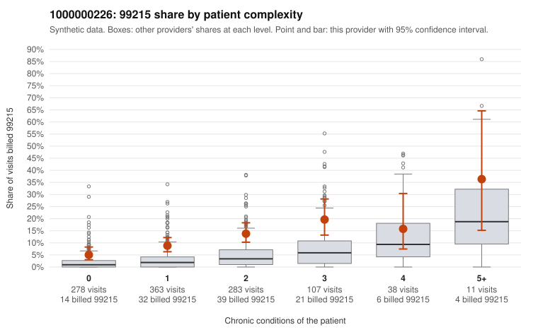

# 1000000226: Provider 1000000226 bills 99215 well above risk-adjusted expectation, including on low-complexity patients, but documentation is too thin to say whether this is upcoding or a legitimately complex panel.

**Leaning (advisory):** Inconclusive

## Why

1000000226 billed 99215 on 10.7% of 1,080 claims against an expected 2.6% given patient complexity (risk-adjusted score 5.78; plain z-score vs peers 1.11). 40% of this provider's 99215 claims were on patients with 0 or 1 chronic conditions. Records came back for 14 claims. Of 3 documented 99215 claims, 0 (0%) were documented below the billed level, against 0% for the comparison providers. 0 of 8 notes claiming moderate-or-higher data reviewed had no lab or test line on the claim. The 99215 share is elevated in every complexity stratum, not just among sicker patients, and the sampled low-complexity 99215 claims carry mostly single symptom or follow-up diagnoses (e.g., R10.9 on C0116092, R21 on C0116456, J06.9 on C0117163, Z09 on C0116942) that would not usually suggest high-complexity decision-making. That is the concerning half of the pattern; the sampled high-complexity 99215 claims (e.g., C0116103, C0117060) look consistent with the billed level. The records review offers some counterweight but little power: all three documented 99215 notes support high MDM, including two on low-complexity patients (C0116937, C0117023), and no data-reviewed notes lacked a lab or test line, so there is no sign of cloned notes in this small sample. With records for only about 1% of claims, the reviewer should first request charts specifically for the low-complexity 99215 claims listed here, checking whether the documented MDM reflects that visit's problems rather than templated text. Examples: C0116550: billed 99213; documented MDM level straightforward, minutes not recorded. C0116057: billed 99215, patient aged 60 with 1 chronic condition(s) (depression). C0116092: billed 99215, patient aged 43 with 0 chronic condition(s).

## Evidence chart

## Cited claims

`C0116550`, `C0116057`, `C0116092`

## Suggested next steps

- Request records for a larger sample of this provider's 99214 and 99215 claims; what came back is too thin to judge.
- Re-screen the provider once the records arrive.

---
Citations checked: 3/3 valid. Synthetic data. The leaning is advisory; the flag comes from the statistical screen, and no clinical documentation is available beyond the sampled records-review facts shown in the packet.
