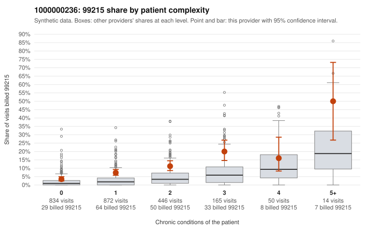

# 1000000236: Elevated 99215 use that is not explained by patient complexity, with roughly half on low-complexity patients, but documentation is far too thin to confirm or rule out upcoding.

**Leaning (advisory):** Inconclusive

## Why

1000000236 billed 99215 on 8.0% of 2,381 claims against an expected 2.3% given patient complexity (risk-adjusted score 6.59; plain z-score vs peers 0.59). 49% of this provider's 99215 claims were on patients with 0 or 1 chronic conditions. Records came back for 14 claims. Of 1 documented 99215 claims, 0 (0%) were documented below the billed level, against 0% for the comparison providers. 0 of 11 notes claiming moderate-or-higher data reviewed had no lab or test line on the claim. The risk-adjusted excess is substantial, and the provider's 99215 share runs above the all-provider rate in every complexity stratum, including patients with zero or one condition. That points toward a coding habit rather than a sicker panel. The low-complexity sample shows several patterns consistent with upcoding: 99215 billed for presentations like upper respiratory infection (C0122799, C0123140, C0123162), rash (C0122504, C0124451) and follow-up-only visits (C0122768, C0124482). By contrast, the high-complexity samples (e.g., C0122574, C0124540) look plausibly appropriate. The key ambiguity is documentation: only one 99215 chart came back (C0123405, supported at high MDM with 53 minutes, despite a single-condition patient), and the lone below-billed note was a 99214, so the records neither confirm nor refute the pattern. A reviewer should first request charts specifically for the low-complexity 99215 claims listed, prioritizing the acute minor-complaint visits, and check whether MDM or time actually support the high level. Examples: C0124052: billed 99214; documented MDM level low, minutes not recorded. C0122409: billed 99215, patient aged 54 with 1 chronic condition(s) (hyperlipidemia). C0122439: billed 99215, patient aged 25 with 1 chronic condition(s) (chronic kidney disease).

## Evidence chart

## Cited claims

`C0124052`, `C0122409`, `C0122439`

## Suggested next steps

- Request records for a larger sample of this provider's 99214 and 99215 claims; what came back is too thin to judge.
- Re-screen the provider once the records arrive.

---
Citations checked: 3/3 valid. Synthetic data. The leaning is advisory; the flag comes from the statistical screen, and no clinical documentation is available beyond the sampled records-review facts shown in the packet.
