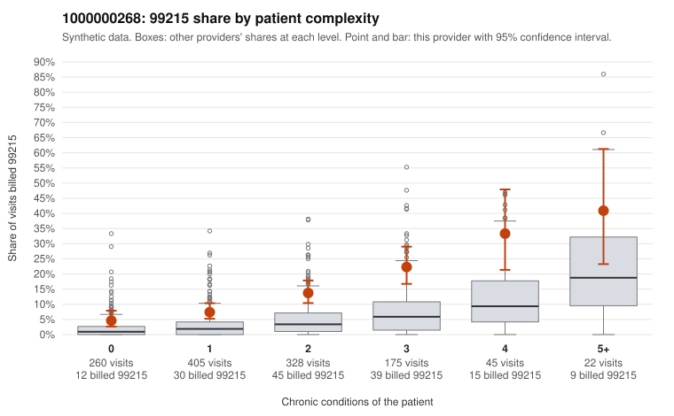

# 1000000268: Provider 1000000268 bills 99215 well above complexity-adjusted expectation in every complexity band, but documentation is too thin to confirm or refute upcoding.

**Leaning (advisory):** Inconclusive

## Why

1000000268 billed 99215 on 12.1% of 1,235 claims against an expected 2.9% given patient complexity (risk-adjusted score 6.78; plain z-score vs peers 1.37). 28% of this provider's 99215 claims were on patients with 0 or 1 chronic conditions. Records came back for 14 claims. Of 3 documented 99215 claims, 0 (0%) were documented below the billed level, against 0% for the comparison providers. 1 of 9 notes claiming moderate-or-higher data reviewed had no lab or test line on the claim. The excess 99215 use is not explained by panel acuity. The provider's 99215 share runs roughly two to three times the all-provider share in every complexity band, including patients with zero or one chronic condition. The low-complexity sample includes visits with simple, acute-appearing diagnoses such as J06.9 (C0140784, C0141230, C0141104), Z09 (C0140169) and N39.0 (C0140997), which is the pattern most consistent with upcoding. Against that, the high-complexity sample (e.g., C0140829, C0140930) looks appropriate for 99215, and all three documented 99215 claims (C0140304, C0140536, C0140798) supported high MDM. Records came back for only about 1% of claims, so the documentation neither clears nor implicates the provider. The one cloned-data signal (one of nine moderate-plus data-reviewed notes with no lab line) is weak. A reviewer should first request charts specifically for the sampled low-complexity 99215 claims, starting with the acute-diagnosis visits, to see whether the notes support high MDM or 40+ minutes. Examples: C0139999: billed 99214; documented MDM level low, 22 minutes. C0140017: billed 99215, patient aged 80 with 1 chronic condition(s) (osteoarthritis). C0140026: billed 99215, patient aged 46 with 1 chronic condition(s) (hypertension).

## Evidence chart

## Cited claims

`C0139999`, `C0140017`, `C0140026`

## Suggested next steps

- Request records for a larger sample of this provider's 99214 and 99215 claims; what came back is too thin to judge.
- Re-screen the provider once the records arrive.

---
Citations checked: 3/3 valid. Synthetic data. The leaning is advisory; the flag comes from the statistical screen, and no clinical documentation is available beyond the sampled records-review facts shown in the packet.
