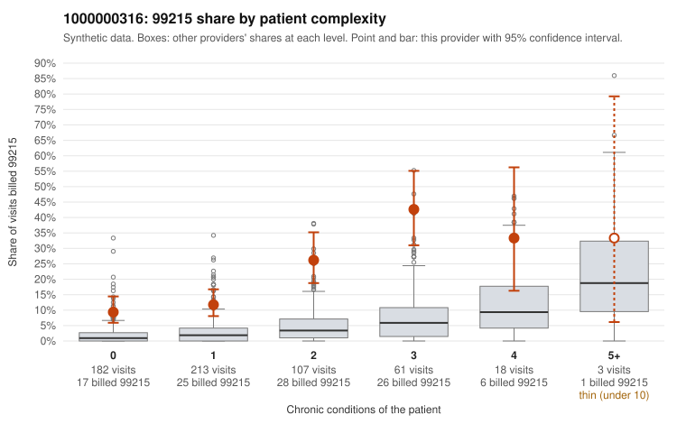

# 1000000316: Elevated 99215 billing that runs well above peers at every complexity tier, including many visits for patients with no or one chronic condition, while documentation is too thin (one charted 99215) to confirm or refute upcoding.

**Leaning (advisory):** Inconclusive

## Why

1000000316 billed 99215 on 17.6% of 584 claims against an expected 2.4% given patient complexity (risk-adjusted score 8.39; plain z-score vs peers 2.41). 41% of this provider's 99215 claims were on patients with 0 or 1 chronic conditions. Records came back for 12 claims. Of 1 documented 99215 claims, 0 (0%) were documented below the billed level, against 0% for the comparison providers. 0 of 8 notes claiming moderate-or-higher data reviewed had no lab or test line on the claim. The billing pattern raises concern. The 99215 share exceeds the all-provider share in every complexity tier, not just among sicker patients, and the sampled low-complexity 99215 claims include visits coded only for routine or minor problems. Examples are follow-up Z09 (C0167933, C0168112), upper respiratory infection J06.9 (C0167804, C0168147), rash R21 (C0168175, C0168196) and uncomplicated hypertension I10 (C0167772, C0168319), which is the pattern most consistent with upcoding. Some of the excess falls on genuinely complex patients, such as C0167866 and C0167889, so part of the elevation may reflect a sicker subset of the panel. The documentation cannot settle the question. Only one 99215 was charted (C0167784, supported at high MDM), and none of the 99213 or 99214 notes were below billed. The data-reviewed notes all had a matching lab or test line, so there is no sign of cloned notes, but the sample is far too small to lean either way. A reviewer should first request charts for the sampled low-complexity 99215 claims, especially the Z09, J06.9 and R21 visits, to see whether the documented MDM or time supports level 5. Examples: C0167727: billed 99215, patient aged 46 with 0 chronic condition(s). C0167772: billed 99215, patient aged 41 with 1 chronic condition(s) (hypertension).

## Evidence chart

## Cited claims

`C0167727`, `C0167772`

## Suggested next steps

- Request records for a larger sample of this provider's 99214 and 99215 claims; what came back is too thin to judge.
- Re-screen the provider once the records arrive.

---
Citations checked: 2/2 valid. Synthetic data. The leaning is advisory; the flag comes from the statistical screen, and no clinical documentation is available beyond the sampled records-review facts shown in the packet.
