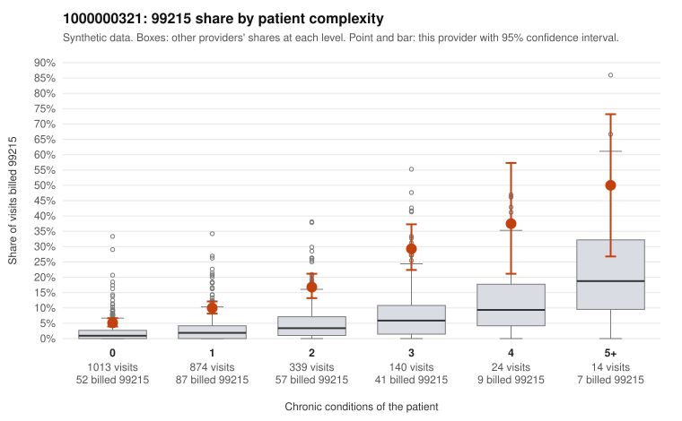

# 1000000321: Provider 1000000321 bills 99215 well above its risk-adjusted expectation, with over half of those claims on low-complexity patients, but records came back for too few claims to confirm or rule out upcoding.

**Leaning (advisory):** Inconclusive

## Why

1000000321 billed 99215 on 10.5% of 2,404 claims against an expected 2.1% given patient complexity (risk-adjusted score 10.28; plain z-score vs peers 1.06). 55% of this provider's 99215 claims were on patients with 0 or 1 chronic conditions. Records came back for 17 claims. Of 3 documented 99215 claims, 0 (0%) were documented below the billed level, against 0% for the comparison providers. 2 of 9 notes claiming moderate-or-higher data reviewed had no lab or test line on the claim. The claims pattern leans toward concern. 99215 rates run above the all-provider share in every complexity band, and the excess is not confined to sicker patients. The low-complexity sample includes 99215s for single acute or minor diagnoses such as upper respiratory infection, abdominal pain, rash and UTI (e.g., C0170304, C0171045, C0171804, C0172506). The high-complexity sample (e.g., C0171316, C0170529) looks plausibly consistent with the billed level. The documentation cannot settle the question: only 3 documented 99215 claims came back, all supported at high MDM, and the 2 data-reviewed notes with no lab or test line are only weak evidence of inflated notes. A reviewer should first request charts specifically for the low-complexity 99215 claims listed, starting with the single-acute-diagnosis visits, to see whether the documented MDM supports level 5 or reads as templated. Examples: C0171582: billed 99213; documented MDM level straightforward, 13 minutes. C0170304: billed 99215, patient aged 39 with 0 chronic condition(s). C0170448: billed 99215, patient aged 39 with 1 chronic condition(s) (obesity).

## Evidence chart

## Cited claims

`C0171582`, `C0170304`, `C0170448`

## Suggested next steps

- Request records for a larger sample of this provider's 99214 and 99215 claims; what came back is too thin to judge.
- Re-screen the provider once the records arrive.

---
Citations checked: 3/3 valid. Synthetic data. The leaning is advisory; the flag comes from the statistical screen, and no clinical documentation is available beyond the sampled records-review facts shown in the packet.
