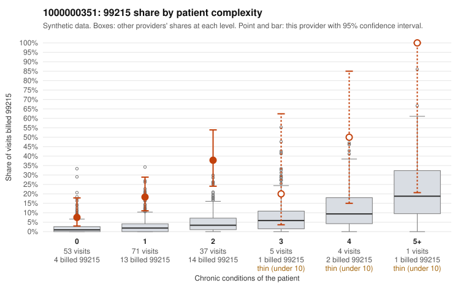

# 1000000351: Provider 1000000351 bills 99215 far above what its patient complexity predicts, with much of it on low-complexity patients, but the few charts returned all support the billed levels, so documentation is too thin to judge.

**Leaning (advisory):** Inconclusive

## Why

1000000351 billed 99215 on 20.5% of 171 claims against an expected 2.2% given patient complexity (risk-adjusted score 5.62; plain z-score vs peers 2.94). 49% of this provider's 99215 claims were on patients with 0 or 1 chronic conditions. Records came back for 17 claims. Of 4 documented 99215 claims, 0 (0%) were documented below the billed level, against 0% for the comparison providers. 1 of 11 notes claiming moderate-or-higher data reviewed had no lab or test line on the claim. The billing pattern raises concern because the 99215 excess appears across every complexity tier, including patients with 0 or 1 chronic conditions. Sampled examples include C0190858, C0190898 and C0190900, which carry only symptom codes such as rash or upper respiratory infection, while the high-complexity examples (C0190802, C0190873) fit the expected picture. Against that, the four documented 99215 charts (including low-complexity C0190883 and C0190964) were all recorded at high MDM, and no documented claim at any level fell below the billed code. Only 1 of 11 moderate-or-higher data-reviewed notes lacked a lab or test line, so there is little sign of inflated notes. With records for only about a tenth of claims and just four 99215 charts, the sample cannot confirm or rule out upcoding. A reviewer should first request charts for the low-complexity 99215 claims listed in the packet and check whether those notes show genuine high-complexity decision-making or templated or cloned language. Examples: C0190815: billed 99215, patient aged 58 with 1 chronic condition(s) (osteoarthritis). C0190837: billed 99215, patient aged 18 with 1 chronic condition(s) (hyperlipidemia).

## Evidence chart

## Cited claims

`C0190815`, `C0190837`

## Suggested next steps

- Request records for a larger sample of this provider's 99214 and 99215 claims; what came back is too thin to judge.
- Re-screen the provider once the records arrive.

---
Citations checked: 2/2 valid. Synthetic data. The leaning is advisory; the flag comes from the statistical screen, and no clinical documentation is available beyond the sampled records-review facts shown in the packet.
