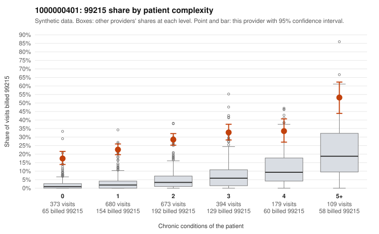

# 1000000401: Provider 1000000401 bills 99215 far above risk-adjusted expectation in every complexity stratum, including on patients with no or one chronic condition, but documentation is too thin to confirm or refute upcoding.

**Leaning (advisory):** Inconclusive

## Why

1000000401 billed 99215 on 27.3% of 2,408 claims against an expected 3.6% given patient complexity (risk-adjusted score 22.51; plain z-score vs peers 4.24). 33% of this provider's 99215 claims were on patients with 0 or 1 chronic conditions. Records came back for 17 claims. Of 4 documented 99215 claims, 0 (0%) were documented below the billed level, against 0% for the comparison providers. 1 of 9 notes claiming moderate-or-higher data reviewed had no lab or test line on the claim. The claims pattern is concerning: the elevated 99215 share holds in every complexity band, not just among sicker patients. A third of 99215s fall on patients with zero or one condition, and the sampled low-complexity 99215s carry symptom-level diagnoses such as R10.9, R21, N39.0 and Z09 (e.g., C0213917, C0214270, C0216257). That pattern is consistent with upcoding rather than a high-acuity panel. Against this, the four documented 99215 claims (e.g., C0214246, C0215063) all showed high MDM with no mismatches, and only one of nine notes claiming moderate-or-higher data reviewed lacked a lab or test line. Records cover under 1% of claims, though, so that documentation cannot be treated as representative. A reviewer should first request charts targeted at the low-complexity 99215 claims (starting with the symptom-only visits listed). They should then check whether those notes support high MDM or look templated or cloned. Examples: C0213751: billed 99215, patient aged 26 with 1 chronic condition(s) (type 2 diabetes). C0213917: billed 99215, patient aged 50 with 0 chronic condition(s).

## Evidence chart

## Cited claims

`C0213751`, `C0213917`

## Suggested next steps

- Request records for a larger sample of this provider's 99214 and 99215 claims; what came back is too thin to judge.
- Re-screen the provider once the records arrive.

---
Citations checked: 2/2 valid. Synthetic data. The leaning is advisory; the flag comes from the statistical screen, and no clinical documentation is available beyond the sampled records-review facts shown in the packet.
