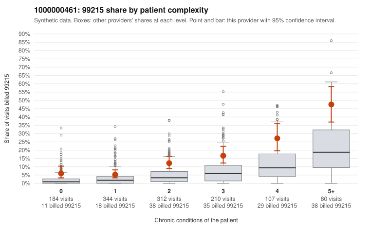

# 1000000461: Provider 1000000461 bills 99215 well above risk-adjusted expectation in every complexity band, but documentation is too thin to tell upcoding from a sicker panel.

**Leaning (advisory):** Inconclusive

## Why

1000000461 billed 99215 on 13.7% of 1,237 claims against an expected 3.9% given patient complexity (risk-adjusted score 6.22; plain z-score vs peers 1.66). 17% of this provider's 99215 claims were on patients with 0 or 1 chronic conditions. Records came back for 17 claims. Of 3 documented 99215 claims, 0 (0%) were documented below the billed level, against 0% for the comparison providers. 3 of 10 notes claiming moderate-or-higher data reviewed had no lab or test line on the claim. The elevated 99215 share is not explained by case mix alone. The provider exceeds the all-provider rate in every chronic-condition band, including patients with zero or one condition, where sampled 99215 claims carry diagnoses such as uncomplicated UTI, low back pain, follow-up exams and upper respiratory infection (e.g., C0248064, C0248590, C0248932, C0249022). That pattern is consistent with upcoding. Against this, the high-complexity sampled 99215s (e.g., C0248059, C0248512) look clinically plausible. The few charts returned all support the billed level, though three of the 99215 supports rest on 'not recorded' or limited time data. Only 17 records came back, with just three documented 99215 claims, so documentation cannot confirm or refute the pattern. The few notes claiming moderate-plus data review without a lab or test line are only weak evidence of templated notes. A reviewer should first request charts for the low-complexity 99215 claims listed in the packet and check whether their MDM and time support level 5. Examples: C0247933: billed 99215, patient aged 62 with 1 chronic condition(s) (hyperlipidemia). C0247974: billed 99215, patient aged 55 with 1 chronic condition(s) (obesity).

## Evidence chart

## Cited claims

`C0247933`, `C0247974`

## Suggested next steps

- Request records for a larger sample of this provider's 99214 and 99215 claims; what came back is too thin to judge.
- Re-screen the provider once the records arrive.

---
Citations checked: 2/2 valid. Synthetic data. The leaning is advisory; the flag comes from the statistical screen, and no clinical documentation is available beyond the sampled records-review facts shown in the packet.
