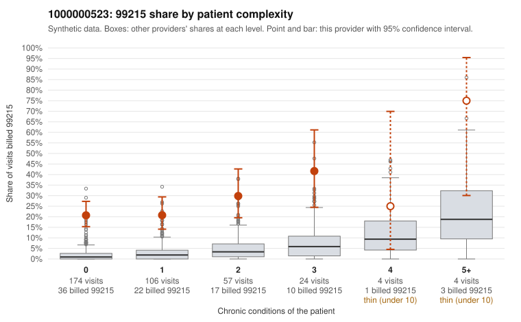

# 1000000523: Provider 1000000523 bills 99215 at roughly ten times the expected rate, mostly on patients with few or no chronic conditions; the small set of returned charts supports the billed level but is too thin to clear the pattern.

**Leaning (advisory):** Pattern consistent with upcoding

## Why

1000000523 billed 99215 on 24.1% of 369 claims against an expected 2.2% given patient complexity (risk-adjusted score 10.32; plain z-score vs peers 3.63). 65% of this provider's 99215 claims were on patients with 0 or 1 chronic conditions. Records came back for 17 claims. Of 8 documented 99215 claims, 0 (0%) were documented below the billed level, against 0% for the comparison providers. 5 of 15 notes claiming moderate-or-higher data reviewed had no lab or test line on the claim. The elevated 99215 share holds across every complexity stratum, including visits with zero chronic conditions. Sampled 99215 claims there carry simple diagnoses such as abdominal pain (C0277180, C0277333), upper respiratory infection (C0277233, C0277420), UTI (C0277232) and follow-up codes (C0277258), which is the concern rather than a sicker panel. The returned charts point the other way, since all 8 documented 99215 claims were supported. But records came back for under 5% of claims, which is too thin to offset the claim-level pattern. Some notes may also be inflated: C0277491, a single-condition hypertension and follow-up visit, is documented as high MDM at 50 minutes. A third of the notes claiming moderate-or-higher data review have no lab or test line on the claim, which is weak evidence that notes may be templated rather than reflecting what happened. A reviewer should first request a larger chart sample focused on 0–1 condition 99215 visits. Those notes should be checked for cloned or templated language, and the documented data review and time compared against orders, results and scheduling records. Examples: C0277180: billed 99215, patient aged 45 with 0 chronic condition(s). C0277184: billed 99215, patient aged 48 with 0 chronic condition(s). C0277186: billed 99215, patient aged 61 with 1 chronic condition(s) (osteoarthritis).

## Evidence chart

## Cited claims

`C0277180`, `C0277184`, `C0277186`

## Suggested next steps

- Request the full records for the cited claims and have a certified coder re-score each against current E/M documentation rules (medical decision making or total time).
- If the re-scoring confirms the pattern, use the sampling plan in the recovery packet to review a statistical sample of this provider's 99215 claims.
- Check whether notes for the cited claims look copied forward, and whether documented minutes repeat from visit to visit.

---
Citations checked: 3/3 valid. Synthetic data. The leaning is advisory; the flag comes from the statistical screen, and no clinical documentation is available beyond the sampled records-review facts shown in the packet.
