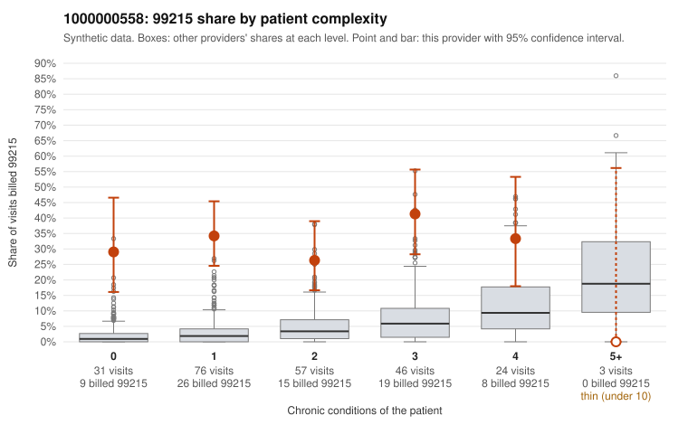

# 1000000558: Provider 1000000558 bills 99215 far above expectation across every complexity tier, including patients with no chronic conditions, but the few charts returned support the billed levels, so the documentation is too thin to settle the question.

**Leaning (advisory):** Inconclusive

## Why

1000000558 billed 99215 on 32.5% of 237 claims against an expected 3.4% given patient complexity (risk-adjusted score 8.76; plain z-score vs peers 5.21). 45% of this provider's 99215 claims were on patients with 0 or 1 chronic conditions. Records came back for 17 claims. Of 6 documented 99215 claims, 0 (0%) were documented below the billed level, against 0% for the comparison providers. 1 of 15 notes claiming moderate-or-higher data reviewed had no lab or test line on the claim. The billing pattern does not look like a sicker panel. The excess 99215 share appears in every complexity stratum, including 0- and 1-condition patients. Sampled examples include single-diagnosis visits for hyperlipidemia, UTI or rash billed at 99215 (e.g., C0292322, C0292349, C0292318), and 99214 dominates the rest of the mix. Against that, all six documented 99215 claims were supported, but six charts is too few to rule upcoding in or out. Some of those supported notes are themselves worth scrutiny: C0292393 (asthma) and C0292460 (hyperlipidemia) record high MDM on single-condition patients with no minutes recorded, which could reflect templated or inflated notes rather than real complexity. The one no-lab mismatch among data-reviewed notes is weak evidence on its own. A reviewer should first request a larger chart sample focused on low-complexity 99215 claims, then compare note content across visits for cloning, starting with the repeat 99215 visits for M0123165 and M0123205. Examples: C0292530: billed 99213; documented MDM level straightforward, minutes not recorded. C0292302: billed 99215, patient aged 28 with 1 chronic condition(s) (asthma). C0292314: billed 99215, patient aged 66 with 1 chronic condition(s) (type 2 diabetes).

## Evidence chart

## Cited claims

`C0292530`, `C0292302`, `C0292314`

## Suggested next steps

- Request records for a larger sample of this provider's 99214 and 99215 claims; what came back is too thin to judge.
- Re-screen the provider once the records arrive.

---
Citations checked: 3/3 valid. Synthetic data. The leaning is advisory; the flag comes from the statistical screen, and no clinical documentation is available beyond the sampled records-review facts shown in the packet.
