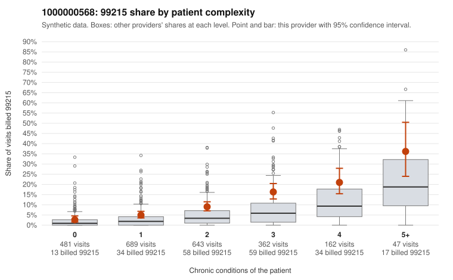

# 1000000568: Provider 1000000568 bills 99215 well above its risk-adjusted expectation in every complexity tier, including low-complexity patients, but no 99215 charts were returned to confirm or refute support.

**Leaning (advisory):** Inconclusive

## Why

1000000568 billed 99215 on 9.0% of 2,384 claims against an expected 3.2% given patient complexity (risk-adjusted score 5.73; plain z-score vs peers 0.78). 22% of this provider's 99215 claims were on patients with 0 or 1 chronic conditions. Records came back for 14 claims. No documented 99215 claims came back. 1 of 12 notes claiming moderate-or-higher data reviewed had no lab or test line on the claim. The excess 99215 billing is not explained by panel acuity alone: this provider's 99215 share runs above the all-provider share in every condition-count tier, and the sampled low-complexity 99215 claims include routine-looking encounters such as follow-up (Z09) on C0296869 and C0297207, upper respiratory infection on C0297375 and C0298230, and UTI on C0297316, which is a pattern consistent with upcoding. Against that, the sampled high-complexity 99215 claims (for example C0297903 and C0297571) involve patients with four or five chronic conditions where a high level is plausible, and the modest peer z-score shows this provider is not a dramatic outlier on unadjusted rates. The documentation is too thin to judge: only 14 charts came back, all billed 99213 or 99214 and all supported, with none at 99215, and the single data-reviewed note with no matching lab line is weak evidence at most. A reviewer should first request records for the low-complexity 99215 claims listed in the packet, starting with the Z09, J06.9 and N39.0 visits, to check whether the documented MDM and time support level 5. Examples: C0296869: billed 99215, patient aged 46 with 0 chronic condition(s). C0297116: billed 99215, patient aged 50 with 1 chronic condition(s) (type 2 diabetes).

## Evidence chart

## Cited claims

`C0296869`, `C0297116`

## Suggested next steps

- Request records for a larger sample of this provider's 99214 and 99215 claims; what came back is too thin to judge.
- Re-screen the provider once the records arrive.

---
Citations checked: 2/2 valid. Synthetic data. The leaning is advisory; the flag comes from the statistical screen, and no clinical documentation is available beyond the sampled records-review facts shown in the packet.
