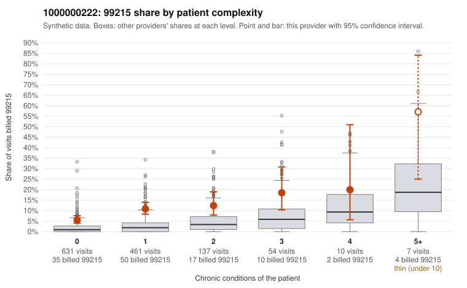

# Payment Integrity dossier: 1000000222

> Draft for human review. Statistical and records-sample evidence only; not a finding. Compliance or legal review is needed before any provider contact, notice or recoupment.

## Provider overview

| | |
|---|---|
| Specialty / state | Family Practice, GA (synthetic) |
| Claims / patients | 1,300 / 630 |
| Billed mix (99211 to 99215) | 7 / 10 / 426 / 739 / 118 |
| 99215 share | 9.1% |
| Expected 99215 share given patient complexity | 1.9% |
| Screen scores | z vs peers 0.79; risk-adjusted 6.56; flagged by suspicion>=5 |

## Case summary (advisory)

**Elevated 99215 use concentrated on low-complexity patients is consistent with upcoding, but records are too thin to confirm it.**

Leaning: pattern consistent with upcoding. Citations checked: 5/5 valid.

1000000222 billed 99215 on 9.1% of 1,300 claims against an expected 1.9% given patient complexity (risk-adjusted score 6.56; plain z-score vs peers 0.79). 72% of this provider's 99215 claims were on patients with 0 or 1 chronic conditions. Records came back for 19 claims. Of 1 documented 99215 claims, 0 (0%) were documented below the billed level, against 0% for the comparison providers. 1 of 9 notes claiming moderate-or-higher data reviewed had no lab or test line on the claim. The claims pattern points toward upcoding rather than a sicker panel. The 99215 share runs above the all-provider rate in every complexity band, and most of this provider's 99215s fall on patients with zero or one chronic condition. Sampled examples such as C0112208 and C0112725 (J06.9 upper respiratory infection, no chronic conditions) and C0112274 (N39.0) show the highest code on what look like routine acute visits, while high-complexity examples like C0112234 fit a level-5 visit. The documentation cannot settle the question: only one 99215 claim was reviewed (C0112125, supported at high MDM), and the few below-billed findings at 99213 and 99214 come from very small counts, so the records neither confirm nor rule out the claims-based signal. A reviewer should first request charts for the sampled low-complexity 99215 claims, especially the acute-diagnosis visits, and check whether the notes support high MDM or are templated, given that one moderate-plus data-reviewed note had no lab or test line on the claim. Examples: C0112713: billed 99213; documented MDM level straightforward, minutes not recorded. C0113234: billed 99214; documented MDM level low, minutes not recorded. C0111966: billed 99215, patient aged 74 with 0 chronic condition(s). C0112010: billed 99215, patient aged 56 with 0 chronic condition(s). C0112075: billed 99215, patient aged 74 with 1 chronic condition(s) (hypertension).

## Evidence chart

## Records-review sample so far

Documentation is on file for 19 claims (2% of this provider's claims).

| Billed | Documented | Documentation below billed level | Rate | All-provider rate |
|---|---|---|---|---|
| 99213 | 6 | 1 | 16.7% | 3.1% |
| 99214 | 11 | 1 | 9.1% | 4.8% |
| 99215 | 1 | 0 | 0.0% | 0.0% |

## Recommended next steps for Payment Integrity

1. Request records for the sampled claims in `record_request_list.csv` (44 claims across 99215).
2. Review the records against E/M documentation rules and record the supported level for each claim.
3. Run the overpayment estimator on the reviewed sample (`sampling_plan.md` explains how).
4. Notice, appeal rights, recoupment, education or corrective action, and any referral are decisions for the PI team, compliance and counsel. Nothing here drafts those.

Suggested follow-ups from the case summary:

- Request the full records for the cited claims and have a certified coder re-score each against current E/M documentation rules (medical decision making or total time).
- If the re-scoring confirms the pattern, use the sampling plan in the recovery packet to review a statistical sample of this provider's 99215 claims.
- Check whether notes for the cited claims look copied forward, and whether documented minutes repeat from visit to visit.

## Limits

- Synthetic data; no real claims or providers.
- The leaning is advisory. The flag comes from the statistical screen; the summary explains it.
- The records-review sample is partial and was simulated for this project.
- Allowed amounts are GA Family Practice averages from a public CMS file, not this provider's actual payments.
