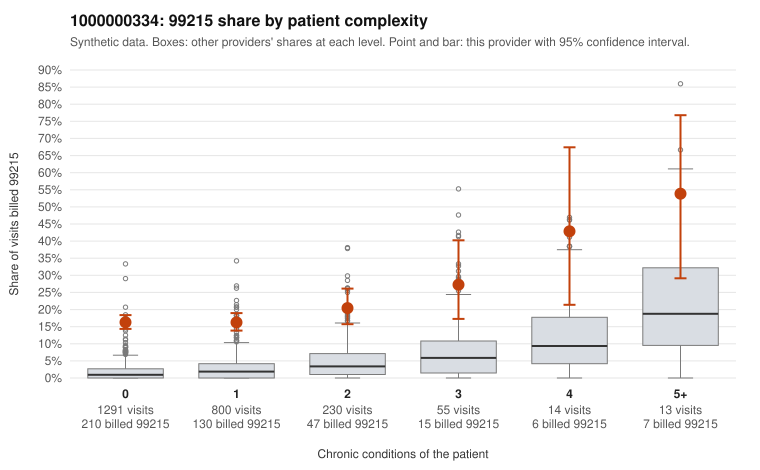

# Payment Integrity dossier: 1000000334

> Draft for human review. Statistical and records-sample evidence only; not a finding. Compliance or legal review is needed before any provider contact, notice or recoupment.

## Provider overview

| | |
|---|---|
| Specialty / state | Family Practice, GA (synthetic) |
| Claims / patients | 2,403 / 1,167 |
| Billed mix (99211 to 99215) | 25 / 18 / 650 / 1,295 / 415 |
| 99215 share | 17.3% |
| Expected 99215 share given patient complexity | 1.8% |
| Screen scores | z vs peers 2.34; risk-adjusted 20.29; flagged by suspicion>=5 |

## Case summary (advisory)

**Provider 1000000334 bills 99215 at roughly nine times the complexity-adjusted expectation, mostly on patients with 0-1 chronic conditions, but records are too thin to confirm or refute the billed levels.**

Leaning: pattern consistent with upcoding. Citations checked: 5/5 valid.

1000000334 billed 99215 on 17.3% of 2,403 claims against an expected 1.8% given patient complexity (risk-adjusted score 20.29; plain z-score vs peers 2.34). 82% of this provider's 99215 claims were on patients with 0 or 1 chronic conditions. Records came back for 16 claims. Of 1 documented 99215 claims, 0 (0%) were documented below the billed level, against 0% for the comparison providers. 2 of 13 notes claiming moderate-or-higher data reviewed had no lab or test line on the claim. The claims pattern is consistent with upcoding. The 99215 share is elevated across every complexity stratum, including patients with no chronic conditions, where it is far above the all-provider share. Most sampled low-complexity 99215 claims carry simple diagnoses such as low back pain (C0179172, C0181215), URI (C0179123) or a follow-up code alone (C0178989, C0179783), which would not usually support high-complexity MDM. The sampled high-complexity 99215 claims (e.g., C0180518, C0181245) look plausible, so the concern centers on the low-complexity stratum. Documentation cannot settle the question: only one 99215 chart came back (C0179129, supported), and the 99214 results and the two moderate-plus data notes with no lab line on the claim are weak signals at most. A reviewer should first request charts for a targeted set of low-complexity 99215 claims, such as those listed above, to check whether the documented MDM and time support the billed level, and should watch for cloned or templated notes. Examples: C0178712: billed 99214; documented MDM level low, 16 minutes. C0180631: billed 99214; documented MDM level low, minutes not recorded. C0178854: billed 99215, patient aged 40 with 1 chronic condition(s) (chronic kidney disease). C0178962: billed 99215, patient aged 51 with 1 chronic condition(s) (hypothyroidism). C0178989: billed 99215, patient aged 37 with 0 chronic condition(s).

## Evidence chart

## Records-review sample so far

Documentation is on file for 16 claims (1% of this provider's claims).

| Billed | Documented | Documentation below billed level | Rate | All-provider rate |
|---|---|---|---|---|
| 99213 | 1 | 0 | 0.0% | 3.1% |
| 99214 | 14 | 2 | 14.3% | 4.8% |
| 99215 | 1 | 0 | 0.0% | 0.0% |

## Recommended next steps for Payment Integrity

1. Request records for the sampled claims in `record_request_list.csv` (59 claims across 99215).
2. Review the records against E/M documentation rules and record the supported level for each claim.
3. Run the overpayment estimator on the reviewed sample (`sampling_plan.md` explains how).
4. Notice, appeal rights, recoupment, education or corrective action, and any referral are decisions for the PI team, compliance and counsel. Nothing here drafts those.

Suggested follow-ups from the case summary:

- Request the full records for the cited claims and have a certified coder re-score each against current E/M documentation rules (medical decision making or total time).
- If the re-scoring confirms the pattern, use the sampling plan in the recovery packet to review a statistical sample of this provider's 99215 claims.
- Check whether notes for the cited claims look copied forward, and whether documented minutes repeat from visit to visit.

## Limits

- Synthetic data; no real claims or providers.
- The leaning is advisory. The flag comes from the statistical screen; the summary explains it.
- The records-review sample is partial and was simulated for this project.
- Allowed amounts are GA Family Practice averages from a public CMS file, not this provider's actual payments.
