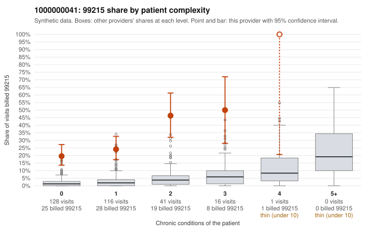

# 1000000041: Provider 1000000041 bills 99215 far above expectation, mostly on low-complexity patients, but only 5 charts came back, too few to confirm or rule out upcoding.

**Leaning (advisory):** Inconclusive

## Why

1000000041 billed 99215 on 26.8% of 302 claims against an expected 2.0% given patient complexity (risk-adjusted score 10.15; plain z-score vs peers 3.38). 65% of this provider's 99215 claims were on patients with 0 or 1 chronic conditions. Records came back for 5 claims. Of 2 documented 99215 claims, 0 (0%) were documented below the billed level, against 14% for the comparison providers. 1 of 4 notes claiming moderate-or-higher data reviewed had no lab or test line on the claim. The claims pattern is concerning. The excess 99215 share holds at every complexity level, not just among sicker patients. Most 99215s fall on patients with 0 or 1 chronic conditions, and sampled examples carry simple diagnoses such as UTI (C0017213, C0017223), upper respiratory infection (C0017168) and follow-up-only Z09 (C0017190, C0017388). The documentation cannot settle it: the 2 documented 99215s (C0017077, C0017242) both support high MDM, but that is far too few charts to weigh against the 14% all-provider unsupported rate, and the one note claiming moderate-plus data review with no lab line is only weak evidence of inflated notes. A reviewer should first request charts for the sampled low-complexity 99215 claims, starting with the zero-condition acute-diagnosis visits, to see whether high MDM is genuinely documented or templated. Examples: C0017076: billed 99215, patient aged 41 with 1 chronic condition(s) (COPD). C0017107: billed 99215, patient aged 41 with 0 chronic condition(s).

## Evidence chart

## Cited claims

`C0017076`, `C0017107`

## Suggested next steps

- Request records for a larger sample of this provider's 99214 and 99215 claims; what came back is too thin to judge.
- Re-screen the provider once the records arrive.

---
Citations checked: 2/2 valid. Synthetic data. The leaning is advisory; the flag comes from the statistical screen, and no clinical documentation is available beyond the sampled records-review facts shown in the packet.
