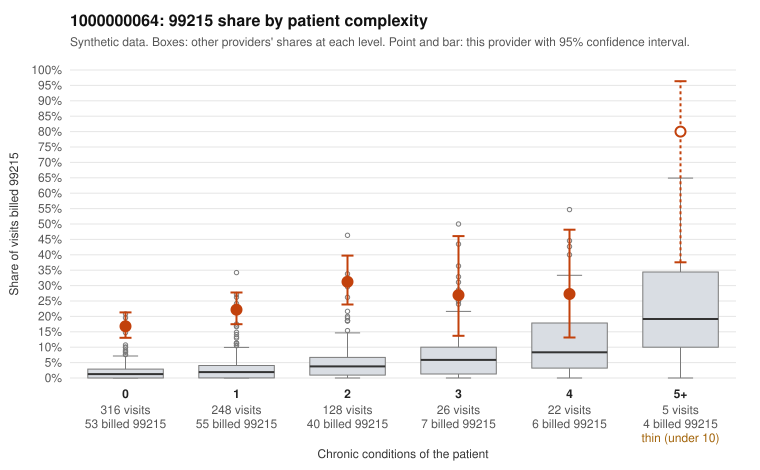

# 1000000064: Provider 1000000064 bills 99215 far above the complexity-adjusted expectation, mostly on patients with few or no chronic conditions, but records came back on too few claims to confirm or rule out upcoding.

**Leaning (advisory):** Inconclusive

## Why

1000000064 billed 99215 on 22.1% of 745 claims against an expected 2.2% given patient complexity (risk-adjusted score 12.11; plain z-score vs peers 2.64). 65% of this provider's 99215 claims were on patients with 0 or 1 chronic conditions. Records came back for 7 claims. Of 1 documented 99215 claims, 0 (0%) were documented below the billed level, against 14% for the comparison providers. 2 of 3 notes claiming moderate-or-higher data reviewed had no lab or test line on the claim. The claims pattern is the main concern. The elevated 99215 share holds in every complexity band, and the excess is largest among patients with 0 or 1 conditions. In the sample, many 99215s carry simple diagnoses such as urinary tract infection, rash, low back pain, upper respiratory infection or follow-up codes (e.g., C0031707, C0031737, C0032123, C0032149), a pattern consistent with upcoding. By contrast, the high-complexity 99215s (e.g., C0031891, C0032325) look plausible. The documentation cannot settle the question: only 1 documented 99215 exists, and while it supports the billed level (C0032208), that single chart is too thin to judge. The 2 of 3 notes claiming moderate-or-higher data reviewed with no lab or test line on the claim are weak evidence of possible note inflation, not proof. A reviewer should first request charts for the low-complexity 99215 claims listed, prioritizing the 0-condition visits with acute minor diagnoses, and check whether documented MDM and time genuinely support level 5. Examples: C0031664: billed 99215, patient aged 18 with 1 chronic condition(s) (type 2 diabetes). C0031667: billed 99215, patient aged 38 with 1 chronic condition(s) (chronic kidney disease).

## Evidence chart

## Cited claims

`C0031664`, `C0031667`

## Suggested next steps

- Request records for a larger sample of this provider's 99214 and 99215 claims; what came back is too thin to judge.
- Re-screen the provider once the records arrive.

---
Citations checked: 2/2 valid. Synthetic data. The leaning is advisory; the flag comes from the statistical screen, and no clinical documentation is available beyond the sampled records-review facts shown in the packet.
