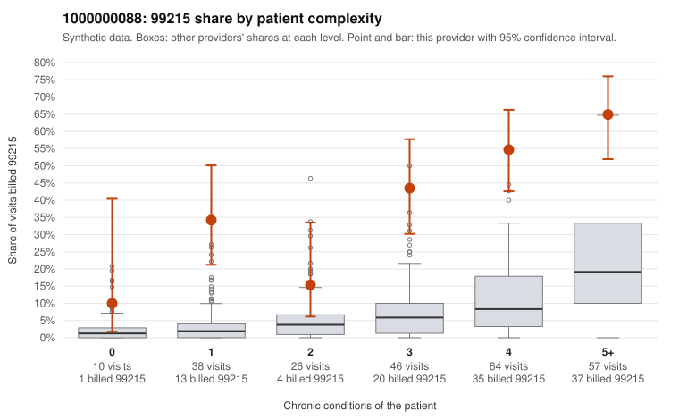

# 1000000088: 1000000088: too few returned records to judge

**Leaning (advisory):** Inconclusive

## Why

1000000088 billed 99215 on 45.6% of 241 claims against an expected 8.2% given patient complexity (risk-adjusted score 7.02; plain z-score vs peers 6.37). 13% of this provider's 99215 claims were on patients with 0 or 1 chronic conditions. Records came back for 4 claims. Of 1 documented 99215 claims, 1 (100%) were documented below the billed level, against 14% for the comparison providers. 0 of 4 notes claiming moderate-or-higher data reviewed had no lab or test line on the claim. The evidence does not support a call either way yet. Examples: C0049895: billed 99215, patient aged 58 with 4 chronic condition(s) (depression;hypertension;COPD;asthma); documented MDM level moderate, 37 minutes. C0049818: billed 99215, patient aged 53 with 1 chronic condition(s) (heart failure). C0049846: billed 99215, patient aged 67 with 1 chronic condition(s) (type 2 diabetes).

## Evidence chart

## Cited claims

`C0049895`, `C0049818`, `C0049846`

## Suggested next steps

- Request records for a larger sample of this provider's 99214 and 99215 claims; what came back is too thin to judge.
- Re-screen the provider once the records arrive.

---
Citations checked: 3/3 valid. Synthetic data. The leaning is advisory; the flag comes from the statistical screen, and no clinical documentation is available beyond the sampled records-review facts shown in the packet.
