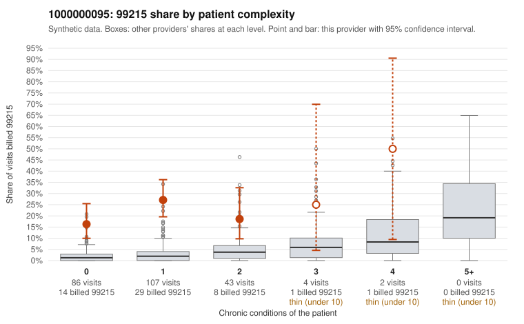

# 1000000095: High 99215 share concentrated on low-complexity patients is consistent with upcoding, but documentation is too thin to confirm or refute it.

**Leaning (advisory):** Inconclusive

## Why

1000000095 billed 99215 on 21.9% of 242 claims against an expected 2.0% given patient complexity (risk-adjusted score 7.20; plain z-score vs peers 2.60). 81% of this provider's 99215 claims were on patients with 0 or 1 chronic conditions. Records came back for 8 claims. Of 1 documented 99215 claims, 0 (0%) were documented below the billed level, against 14% for the comparison providers. 1 of 7 notes claiming moderate-or-higher data reviewed had no lab or test line on the claim. The claims pattern itself points toward upcoding: the 99215 share far exceeds the risk-adjusted expectation and most 99215s fall on patients with zero or one chronic condition. The sampled low-complexity 99215s carry simple diagnoses such as abdominal pain, back pain, rash and UTI (e.g., C0053304, C0053313, C0053349, C0053375), and the share is elevated in every complexity band rather than tracking patient burden. Against that, the records review returned only a handful of charts and a single documented 99215 (C0053492), which recorded high MDM for a UTI visit, so the documentation is too thin to support a lean either way. The one moderate-plus data-reviewed note with no lab or test line on the claim is weak evidence at most. A reviewer should first obtain a larger set of charts targeted at the low-complexity 99215 claims and check whether documented MDM and time genuinely support level 5 for these routine presentations, watching for cloned or templated notes. Examples: C0053291: billed 99215, patient aged 51 with 1 chronic condition(s) (type 2 diabetes). C0053304: billed 99215, patient aged 46 with 0 chronic condition(s).

## Evidence chart

## Cited claims

`C0053291`, `C0053304`

## Suggested next steps

- Request records for a larger sample of this provider's 99214 and 99215 claims; what came back is too thin to judge.
- Re-screen the provider once the records arrive.

---
Citations checked: 2/2 valid. Synthetic data. The leaning is advisory; the flag comes from the statistical screen, and no clinical documentation is available beyond the sampled records-review facts shown in the packet.
