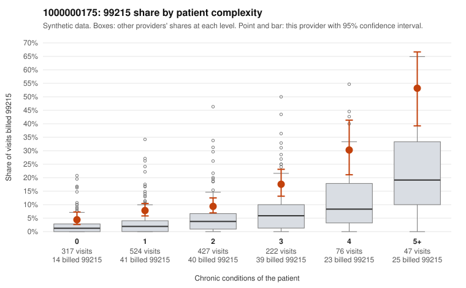

# 1000000175: Provider 1000000175 bills 99215 well above risk-adjusted expectation across every complexity tier, but with records for only 5 claims the documentation is too thin to separate upcoding from a sicker panel.

**Leaning (advisory):** Inconclusive

## Why

1000000175 billed 99215 on 11.3% of 1,613 claims against an expected 3.3% given patient complexity (risk-adjusted score 5.87; plain z-score vs peers 0.92). 30% of this provider's 99215 claims were on patients with 0 or 1 chronic conditions. Records came back for 5 claims. Of 3 documented 99215 claims, 0 (0%) were documented below the billed level, against 14% for the comparison providers. 1 of 5 notes claiming moderate-or-higher data reviewed had no lab or test line on the claim. The elevated 99215 share holds within each chronic-condition tier, not just among complex patients, at roughly double the all-provider share in every row. That, plus the 30% of 99215s on patients with 0 or 1 conditions, is a pattern consistent with upcoding rather than case mix alone. Low-complexity samples billed 99215 for diagnoses such as low back pain, abdominal pain, rash and follow-up visits (e.g., C0100476, C0100558, C0100594, C0101428) look out of step with the highest E/M level. Against this, the three documented 99215s (C0100682, C0100782, C0100859) all show high MDM, and the modest peer z-score suggests the raw share is not extreme by itself. Three charts cannot outweigh the tier-level pattern, and minutes were not recorded, so a reviewer should first request records for the sampled low-complexity 99215 claims and check whether high MDM is genuinely supported or reflects templated or cloned notes, including the one moderate-plus data-reviewed note with no lab or test line. Examples: C0100476: billed 99215, patient aged 33 with 0 chronic condition(s). C0100558: billed 99215, patient aged 44 with 0 chronic condition(s).

## Evidence chart

## Cited claims

`C0100476`, `C0100558`

## Suggested next steps

- Request records for a larger sample of this provider's 99214 and 99215 claims; what came back is too thin to judge.
- Re-screen the provider once the records arrive.

---
Citations checked: 2/2 valid. Synthetic data. The leaning is advisory; the flag comes from the statistical screen, and no clinical documentation is available beyond the sampled records-review facts shown in the packet.
