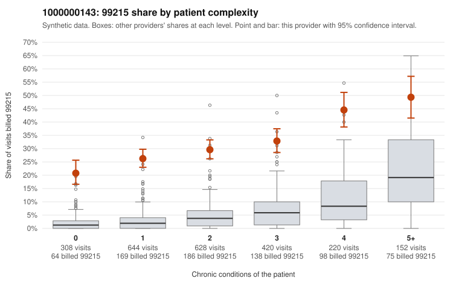

# 1000000143: Elevated 99215 billing persists across every complexity stratum, including many visits for patients with no or one chronic condition, but documentation is too thin to confirm or refute upcoding.

**Leaning (advisory):** Inconclusive

## Why

1000000143 billed 99215 on 30.8% of 2,372 claims against an expected 4.3% given patient complexity (risk-adjusted score 21.24; plain z-score vs peers 4.01). 32% of this provider's 99215 claims were on patients with 0 or 1 chronic conditions. Records came back for 14 claims. Of 5 documented 99215 claims, 2 (40%) were documented below the billed level, against 5% for the comparison providers. 1 of 10 notes claiming moderate-or-higher data reviewed had no lab or test line on the claim. The billing pattern raises concern because the excess 99215 share is not confined to sicker patients. It appears in every complexity band, and the gap relative to peers is largest for patients with zero or one chronic condition. Sampled low-complexity 99215 claims such as C0076994, C0077539 and C0077894 (J06.9 only) and C0077102 (N39.0 only) carry diagnoses that would not usually support high-complexity MDM. The rule check found too few documented claims to lean either way. The 2 of 5 documented 99215s recorded at moderate MDM (C0076995, C0077137) are suggestive, but five charts cannot separate upcoding from documentation noise. Likewise, the single moderate-plus data-reviewed note without a lab line is weak evidence at most. A reviewer should first pull charts for a larger sample of 99215 claims, prioritizing the 0–1 condition visits listed here, and check whether MDM or time actually supports level 5. Examples: C0076995: billed 99215; documented MDM level moderate, minutes not recorded. C0077137: billed 99215; documented MDM level moderate, minutes not recorded. C0076565: billed 99215, patient aged 55 with 1 chronic condition(s) (hyperlipidemia). C0076824: billed 99215, patient aged 59 with 1 chronic condition(s) (type 2 diabetes).

## Evidence chart

## Cited claims

`C0076995`, `C0077137`, `C0076565`, `C0076824`

## Suggested next steps

- Request records for a larger sample of this provider's 99214 and 99215 claims; what came back is too thin to judge.
- Re-screen the provider once the records arrive.

---
Citations checked: 4/4 valid. Synthetic data. The leaning is advisory; the flag comes from the statistical screen, and no clinical documentation is available beyond the sampled records-review facts shown in the packet.
